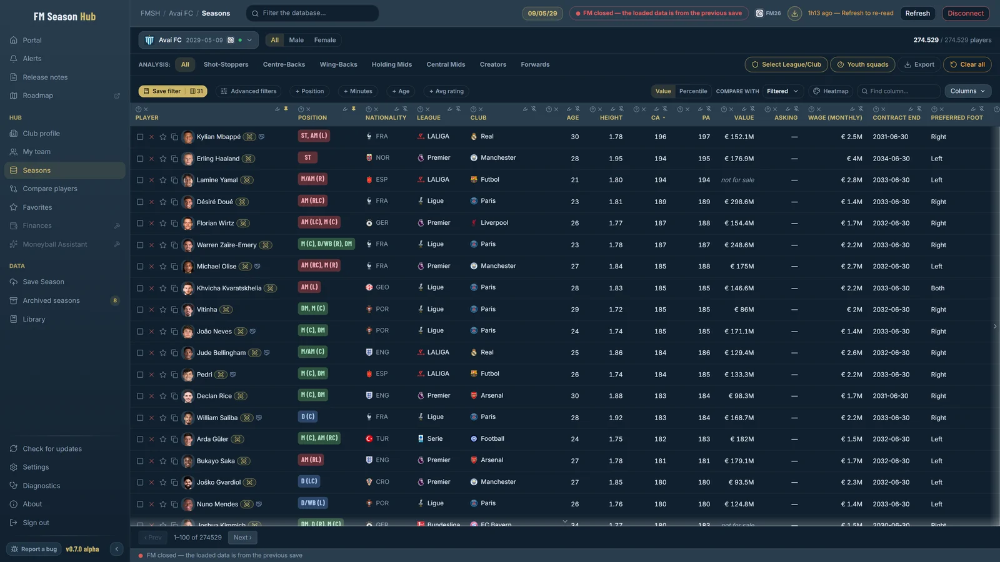
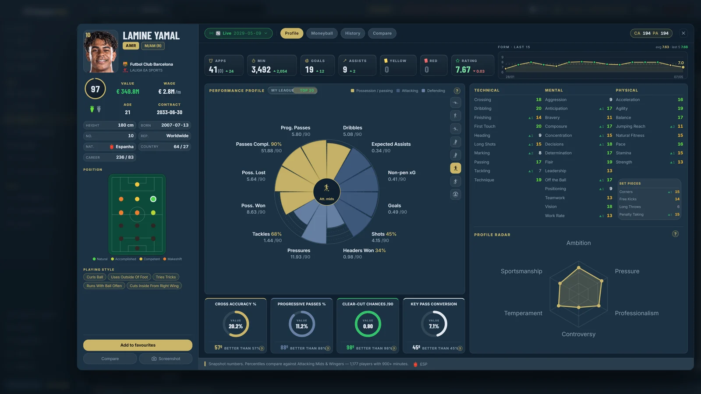

# Atlas de referencias visuales

Tres capturas oficiales seleccionadas del [kit editorial de FM Season Hub](https://www.fmseasonhub.com/en/media-kit), seis capturas históricas que ya estaban en el repositorio, cinco láminas originales de discusión y diez referencias externas sin copia. El kit identifica las pantallas como **FM26** y ofrece versiones mayores en un paquete separado. Los tres archivos conservados son las imágenes web de 1600 × 900. El [manifiesto](references/manifest.json) registra por recurso autor/producto, URL de origen, fecha, función, dominio, archivo si existe, procedencia, patrón, observación y restricciones. Para los archivos añade dimensiones y huella SHA-256.

### Leer una selección y su detalle

**R02 · Captura oficial.** La identidad encabeza cada fila incluso cuando aumenta el número de columnas. En la parte superior conviven presets y menús de filtros. Para Faro probaríamos un resumen legible de los criterios activos y un acceso distinto para editar las columnas. [Captura en origen](https://www.fmseasonhub.com/media-kit/img/print-en-base.webp)

**R03 · Captura oficial.** La pizza permite reconocer un perfil de un vistazo. Para contestar cuál de dos jugadores produce más por 90, el usuario también necesita leer magnitud, minutos y referente. Las etiquetas del gráfico compiten por espacio con otras dos columnas de detalle. [Captura en origen](https://www.fmseasonhub.com/media-kit/img/print-en-perfil.webp)

**D01 · Estudio propio, datos ficticios.** De un mismo par se obtienen dos diferencias útiles, +11 puntos en encaje y entre +1 y +3 en Regate. El hueco en precio sigue siendo visible aunque haya valor de FM. Esta composición admite tabla equivalente a menor ancho. [Datos de Faro](../ux-ui/05-especificacion-prototipo-html.md)

### Inventario por recurso

| ID | Dominio y superficie | Qué examinar al abrirla | Evidencia |
|---|---|---|---|
| R01 | dashboard · Portal | Cambio de temporada junto a selección de equipo. Las tarjetas inferiores mezclan atajos, datos y estados vacíos. | [Abrir archivo](references/dashboard/fmsh-portal.webp) · [Origen](https://www.fmseasonhub.com/media-kit/img/print-en-portal.webp) |
| R02 | scouting · Base de jugadores | Filtros en bandas sobre columnas alineadas. La posición ocupa poco espacio. La cantidad de criterios exige un resumen activo. | [Abrir archivo](references/scouting/fmsh-base.webp) · [Origen](https://www.fmseasonhub.com/media-kit/img/print-en-base.webp) |
| R03 | statistics · Ficha de jugador | Identidad y campograma a la izquierda, pizza central, atributos agrupados a la derecha. La pizza y el radar de personalidad responden a preguntas diferentes. El material muestra campos que en FM27 Analyzer tienen control de permiso. | [Abrir archivo](references/statistics/fmsh-perfil.webp) · [Origen](https://www.fmseasonhub.com/media-kit/img/print-en-perfil.webp) |
| R04 | dashboard · Vista general | Campo de fuerza posicional junto a tabla. Los totales económicos en cabecera tienen un ámbito de equipo. | [Abrir archivo](../../old_version/docs/screenshots/en/dashboard.png) · [Origen](https://github.com/ElectroHugin/FM-Player-Analyzer/blob/126c97007946604b4e83bb6c089b473442581753/docs/screenshots/en/dashboard.png) |
| R05 | players · Perfil | Resumen de mejores roles por fase antes del detalle. Las etiquetas cortas necesitan una explicación y cobertura. | [Abrir archivo](../../old_version/docs/screenshots/en/profile.png) · [Origen](https://github.com/ElectroHugin/FM-Player-Analyzer/blob/126c97007946604b4e83bb6c089b473442581753/docs/screenshots/en/profile.png) |
| R06 | players · Comparador | Dos perfiles radiales encima del detalle tabular. La tabla permite recuperar diferencias que la superposición oculta. | [Abrir archivo](../../old_version/docs/screenshots/en/comparison.png) · [Origen](https://github.com/ElectroHugin/FM-Player-Analyzer/blob/126c97007946604b4e83bb6c089b473442581753/docs/screenshots/en/comparison.png) |
| R07 | tactics · Mejor XI | Dos campos, posesión y sin posesión, con huecos. Seguir al mismo UID requiere una señal que funcione al reducir ancho. | [Abrir archivo](../../old_version/docs/screenshots/en/best-xi.png) · [Origen](https://github.com/ElectroHugin/FM-Player-Analyzer/blob/126c97007946604b4e83bb6c089b473442581753/docs/screenshots/en/best-xi.png) |
| R08 | development · Evolución DWRS | Series pequeñas junto a la fila y serie de selección a la derecha. El eje temporal del sucesor debe identificar cortes y discontinuidades. | [Abrir archivo](../../old_version/docs/screenshots/en/development.png) · [Origen](https://github.com/ElectroHugin/FM-Player-Analyzer/blob/126c97007946604b4e83bb6c089b473442581753/docs/screenshots/en/development.png) |
| R09 | components · Cobertura por rol | Tabla de cobertura seguida de fortalezas y carencias. La selección da contexto al desglose de marcas. | [Abrir archivo](../../old_version/docs/screenshots/en/role-analysis.png) · [Origen](https://github.com/ElectroHugin/FM-Player-Analyzer/blob/126c97007946604b4e83bb6c089b473442581753/docs/screenshots/en/role-analysis.png) |
| D01 | players · Par de refuerzo | Referencia, candidato, delta e importe indeterminado. Las notas son las predefinidas en el guion de Faro. | [Abrir archivo](references/players/comparacion-faro.png) · [Origen](../ux-ui/05-especificacion-prototipo-html.md) |
| D02 | tactics · Selección por fase | Identidad constante en dos disposiciones. Representación orientativa de la posición con/sin posesión. | [Abrir archivo](references/tactics/fases-faro.png) · [Origen](../ux-ui/05-especificacion-prototipo-html.md) |
| D03 | development · Evolución entre dos cierres | Dos escalas separadas, fechas comunes. Los datos de la fixture permiten comparar extremos sin inventar observaciones intermedias. | [Abrir archivo](references/development/cierres-faro.png) · [Origen](../ux-ui/05-especificacion-prototipo-html.md) |
| D04 | navigation · Ida y vuelta al puesto | Cada paso conserva contexto necesario para el siguiente. La cifra económica depende de adoptar un importe hipotético. | [Abrir archivo](references/navigation/recorrido-refuerzo.png) · [Origen](../ux-ui/05-especificacion-prototipo-html.md) |
| D05 | components · Estados de celda | Texto, intervalo y procedencia con señal redundante. El color refuerza un texto suficiente por sí solo. | [Abrir archivo](references/components/estados-del-dato.png) · [Origen](../ux-ui/05-especificacion-prototipo-html.md) |
| E01 | scouting · Modo Moneyball | Columnas de producción en un listado. Imagen enlazada por la web del autor. Contrastar con la descripción de los tres modos. | Sólo enlace · [Origen](https://scoutsheet.fm/img/moneyball-1600.webp) |
| E02 | players · Comparación | Par de jugadores lado a lado. Referencia adicional enlazada desde el kit. | Sólo enlace · [Origen](https://www.fmseasonhub.com/media-kit/img/print-en-comparar.webp) |
| E03 | scouting · Guía de búsqueda e informes | De filtros por zona a lista reutilizable. El soporte describe el recorrido y enlaza demostraciones. | Sólo enlace · [Origen](https://www.hudl.com/support/wyscout/guides/analysis-reports) |
| E04 | statistics · Distribuciones de jugadores | Una población además de la forma radial. Ejemplo histórico del fabricante. | Sólo enlace · [Origen](https://blogarchive.statsbomb.com/articles/soccer/statsbomb-release-not-radars/) |
| E05 | statistics · Radar y Plot | Plantilla de posición y cohorte de percentiles. La guía contiene sus propias ilustraciones. Algunas funciones se describen para Pro. | Sólo enlace · [Origen](https://datamb.football/guide/) |
| E06 | tactics · Mapa de actividad | Densidad espacial frente a actividad cuantificada. Sólo planteable con una fuente de coordenadas. | Sólo enlace · [Origen](https://www.sofascore.com/news/football-player-performance-how-to-use-heatmaps-stats-and-attribute-overviews-to-measure-contribution?amp=1) |
| E07 | statistics · Informe histórico de ojeo | Valor contextual con percentil y periodo. La fuente avisa de la discontinuación. Referencia documental. | Sólo enlace · [Origen](https://fbref.com/en/about/scouting-reports-explained) |
| E08 | development · Historial de movimientos | Fecha y precio asociados a cada traspaso. Fuente editorial indexada. El detalle de un usuario autenticado queda fuera de la observación. | Sólo enlace · [Origen](https://www.transfermarkt.com/intern/datenpflegeGuide) |
| E09 | players · Tablas por posición y edad | Ordenación y consulta por fila para abrir el histórico. Referencia textual del autor. | Sólo enlace · [Origen](https://github.com/jamiebolden/fm-scoring#the-pages) |
| E10 | navigation · Navegación adaptativa | Selección y panel que cambia con el ancho. Muestra oficial de XAML, sin copiar sus recursos. | Sólo enlace · [Origen](https://github.com/microsoft/WinUI-Gallery/blob/main/WinUIGallery/Samples/NavigationView/NavigationViewPage.xaml) |

Los archivos de prensa ilustran el análisis editorial de FMSH. Las seis imágenes del antecedente se abren desde su ubicación original. Marcas, rostros, datos, código y recursos tienen procedencias distintas. Para la futura demostración se emplearán exclusivamente datos ficticios y gráficos propios. [Decisiones DP-07 y DP-09](../PRODUCT-DECISIONS.md)
