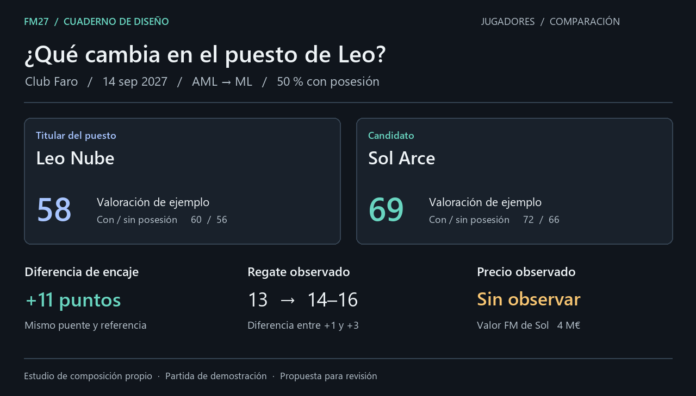

# Atlas de referencias visuales

El [tablero comparativo](15-comparativas-visuales.md) pone dos o tres presentaciones de una tarea a la vista. El atlas contiene 50 entradas. Hay **32 imágenes locales**: seis capturas del kit de FM Season Hub (FM26), nueve capturas del antecedente, diez imágenes de documentación técnica o productos de otros dominios y siete estudios propios con datos ficticios. Las 18 entradas restantes enlazan imágenes o documentación en origen. El [manifiesto](references/manifest.json) distingue procedencia, dimensiones, huella y restricciones por archivo.

### Leer una selección y su detalle

**R02 · Captura oficial.** La identidad encabeza cada fila incluso cuando aumenta el número de columnas. En la parte superior conviven presets y menús de filtros. Para Faro probaríamos un resumen legible de los criterios activos y un acceso distinto para editar las columnas. [Captura en origen](https://www.fmseasonhub.com/media-kit/img/print-en-base.webp)

**R03 · Captura oficial.** La pizza permite reconocer un perfil de un vistazo. Para contestar cuál de dos jugadores produce más por 90, el usuario también necesita leer magnitud, minutos y referente. Las etiquetas del gráfico compiten por espacio con otras dos columnas de detalle. [Captura en origen](https://www.fmseasonhub.com/media-kit/img/print-en-perfil.webp)

**D01 · Estudio propio, datos ficticios.** De un mismo par se obtienen dos diferencias útiles, +11 puntos en encaje y entre +1 y +3 en Regate. El hueco en precio sigue siendo visible aunque haya valor de FM. Esta composición admite tabla equivalente a menor ancho. [Datos de Faro](../ux-ui/05-especificacion-prototipo-html.md)

### Inventario por recurso

| ID | Dominio y superficie | Qué examinar al abrirla | Evidencia |
|---|---|---|---|
| R01 | dashboard · Portal | Cambio de temporada junto a selección de equipo. Las tarjetas inferiores mezclan atajos, datos y estados vacíos. | [Abrir archivo](references/dashboard/fmsh-portal.webp) · [Origen](https://www.fmseasonhub.com/media-kit/img/print-en-portal.webp) |
| R02 | scouting · Base de jugadores | Filtros en bandas sobre columnas alineadas. La posición ocupa poco espacio. La cantidad de criterios exige un resumen activo. | [Abrir archivo](references/scouting/fmsh-base.webp) · [Origen](https://www.fmseasonhub.com/media-kit/img/print-en-base.webp) |
| R03 | statistics · Ficha de jugador | Identidad y campograma a la izquierda, pizza central, atributos agrupados a la derecha. La pizza y el radar de personalidad responden a preguntas diferentes. El material muestra campos que en FM27 Analyzer tienen control de permiso. | [Abrir archivo](references/statistics/fmsh-perfil.webp) · [Origen](https://www.fmseasonhub.com/media-kit/img/print-en-perfil.webp) |
| R04 | dashboard · Vista general | Campo de fuerza posicional junto a tabla. Los totales económicos en cabecera tienen un ámbito de equipo. | [Abrir archivo](../../old_version/docs/screenshots/en/dashboard.png) · [Origen](https://github.com/ElectroHugin/FM-Player-Analyzer/blob/126c97007946604b4e83bb6c089b473442581753/docs/screenshots/en/dashboard.png) |
| R05 | players · Perfil | Resumen de mejores roles por fase antes del detalle. Las etiquetas cortas necesitan una explicación y cobertura. | [Abrir archivo](../../old_version/docs/screenshots/en/profile.png) · [Origen](https://github.com/ElectroHugin/FM-Player-Analyzer/blob/126c97007946604b4e83bb6c089b473442581753/docs/screenshots/en/profile.png) |
| R06 | players · Comparador | Dos perfiles radiales encima del detalle tabular. La tabla permite recuperar diferencias que la superposición oculta. | [Abrir archivo](../../old_version/docs/screenshots/en/comparison.png) · [Origen](https://github.com/ElectroHugin/FM-Player-Analyzer/blob/126c97007946604b4e83bb6c089b473442581753/docs/screenshots/en/comparison.png) |
| R07 | tactics · Mejor XI | Dos campos, posesión y sin posesión, con huecos. Seguir al mismo UID requiere una señal que funcione al reducir ancho. | [Abrir archivo](../../old_version/docs/screenshots/en/best-xi.png) · [Origen](https://github.com/ElectroHugin/FM-Player-Analyzer/blob/126c97007946604b4e83bb6c089b473442581753/docs/screenshots/en/best-xi.png) |
| R08 | development · Evolución DWRS | Series pequeñas junto a la fila y serie de selección a la derecha. El eje temporal del sucesor debe identificar cortes y discontinuidades. | [Abrir archivo](../../old_version/docs/screenshots/en/development.png) · [Origen](https://github.com/ElectroHugin/FM-Player-Analyzer/blob/126c97007946604b4e83bb6c089b473442581753/docs/screenshots/en/development.png) |
| R09 | components · Cobertura por rol | Tabla de cobertura seguida de fortalezas y carencias. La selección da contexto al desglose de marcas. | [Abrir archivo](../../old_version/docs/screenshots/en/role-analysis.png) · [Origen](https://github.com/ElectroHugin/FM-Player-Analyzer/blob/126c97007946604b4e83bb6c089b473442581753/docs/screenshots/en/role-analysis.png) |
| D01 | players · Par de refuerzo | Referencia, candidato, delta e importe indeterminado. Las notas son las predefinidas en el guion de Faro. | [Abrir archivo](references/players/comparacion-faro.png) · [Origen](../ux-ui/05-especificacion-prototipo-html.md) |
| D02 | tactics · Selección por fase | Identidad constante en dos disposiciones. Representación orientativa de la posición con/sin posesión. | [Abrir archivo](references/tactics/fases-faro.png) · [Origen](../ux-ui/05-especificacion-prototipo-html.md) |
| D03 | development · Evolución entre dos cierres | Dos escalas separadas, fechas comunes. Los datos de la fixture permiten comparar extremos sin inventar observaciones intermedias. | [Abrir archivo](references/development/cierres-faro.png) · [Origen](../ux-ui/05-especificacion-prototipo-html.md) |
| D04 | navigation · Ida y vuelta al puesto | Cada paso conserva contexto necesario para el siguiente. La cifra económica depende de adoptar un importe hipotético. | [Abrir archivo](references/navigation/recorrido-refuerzo.png) · [Origen](../ux-ui/05-especificacion-prototipo-html.md) |
| D05 | components · Estados de celda | Texto, intervalo y procedencia con señal redundante. El color refuerza un texto suficiente por sí solo. | [Abrir archivo](references/components/estados-del-dato.png) · [Origen](../ux-ui/05-especificacion-prototipo-html.md) |
| D06 | statistics · Producción frente a salario en Cabo | Selección por jugador enlazada a tasa, total, percentil y salario. N=24 antes y después de filtrar resultados por percentil. La recta surge de esta fixture sintética, sin valor predictivo. | [Abrir archivo](references/statistics/cohorte-cabo.png) · [Origen](../ux-ui/05-especificacion-prototipo-html.md) |
| E01 | scouting · Modo Moneyball | Columnas de producción en un listado. Imagen enlazada por la web del autor. Contrastar con la descripción de los tres modos. | Sólo enlace · [Origen](https://scoutsheet.fm/img/moneyball-1600.webp) |
| E02 | players · Duelo | Jugadores enfrentados alrededor de una zona de métricas común. Mantener visible el referente al desplegar una diferencia. | [Abrir archivo](references/players/fmsh-comparar.webp) · [Origen](https://www.fmseasonhub.com/media-kit/img/print-en-comparar.webp) |
| E03 | scouting · Guía de búsqueda e informes | De filtros por zona a lista reutilizable. El soporte describe el recorrido y enlaza demostraciones. | Sólo enlace · [Origen](https://www.hudl.com/support/wyscout/guides/analysis-reports) |
| E04 | statistics · Distribuciones de jugadores | Una población además de la forma radial. Ejemplo histórico del fabricante. | Sólo enlace · [Origen](https://blogarchive.statsbomb.com/articles/soccer/statsbomb-release-not-radars/) |
| E05 | statistics · Radar y Plot | Plantilla de posición y cohorte de percentiles. La guía contiene sus propias ilustraciones. Algunas funciones se describen para Pro. | Sólo enlace · [Origen](https://datamb.football/guide/) |
| E06 | tactics · Mapa de actividad | Densidad espacial frente a actividad cuantificada. Sólo planteable con una fuente de coordenadas. | Sólo enlace · [Origen](https://www.sofascore.com/news/football-player-performance-how-to-use-heatmaps-stats-and-attribute-overviews-to-measure-contribution?amp=1) |
| E07 | statistics · Informe histórico de ojeo | Valor contextual con percentil y periodo. La fuente avisa de la discontinuación. Referencia documental. | Sólo enlace · [Origen](https://fbref.com/en/about/scouting-reports-explained) |
| E08 | development · Historial de movimientos | Fecha y precio asociados a cada traspaso. Fuente editorial indexada. El detalle de un usuario autenticado queda fuera de la observación. | Sólo enlace · [Origen](https://www.transfermarkt.com/intern/datenpflegeGuide) |
| E09 | players · Tablas por posición y edad | Ordenación y consulta por fila para abrir el histórico. Referencia textual del autor. | Sólo enlace · [Origen](https://github.com/jamiebolden/fm-scoring#the-pages) |
| E10 | navigation · Navegación adaptativa | Selección y panel que cambia con el ancho. Muestra oficial de XAML, sin copiar sus recursos. | Sólo enlace · [Origen](https://github.com/microsoft/WinUI-Gallery/blob/main/WinUIGallery/Samples/NavigationView/NavigationViewPage.xaml) |
| R10 | players · Ficha rápida | Tarjeta de identidad superpuesta a la fila de resultados. El fondo conserva la lista. Probar apertura y cierre con teclado. | [Abrir archivo](references/players/fmsh-tarjeta.webp) · [Origen](https://www.fmseasonhub.com/media-kit/img/print-en-cartao-rapido.webp) |
| R11 | scouting · Mi equipo | Cifras por jugador en columnas con distintivos de estado. Ordenar contratos o rendimiento exige mantener sus unidades visibles. | [Abrir archivo](references/scouting/fmsh-equipo.webp) · [Origen](https://www.fmseasonhub.com/media-kit/img/print-en-meu-time.webp) |
| R12 | tactics · Explorador táctico | Matriz compacta de tácticas y desglose de la selección debajo. Comparar formaciones sin tener que memorizar dos dibujos. | [Abrir archivo](../../old_version/docs/screenshots/en/tactic-explorer.png) · [Origen](https://github.com/ElectroHugin/FM-Player-Analyzer/blob/126c97007946604b4e83bb6c089b473442581753/docs/screenshots/en/tactic-explorer.png) |
| R13 | development · Entrenamiento | Un plan de entrenamiento por persona en filas consecutivas. Adecuado para revisar varios planes a la vez. | [Abrir archivo](../../old_version/docs/screenshots/en/training.png) · [Origen](https://github.com/ElectroHugin/FM-Player-Analyzer/blob/126c97007946604b4e83bb6c089b473442581753/docs/screenshots/en/training.png) |
| R14 | tactics · Inscripción | Listados agrupados de inscripción con estado por persona. El recuento necesita una causa cuando falta evidencia sobre una reserva. | [Abrir archivo](../../old_version/docs/screenshots/en/registration.png) · [Origen](https://github.com/ElectroHugin/FM-Player-Analyzer/blob/126c97007946604b4e83bb6c089b473442581753/docs/screenshots/en/registration.png) |
| R15 | navigation · Conversación y editor | Conversación en un panel al lado del documento de trabajo. Permite retener la evidencia deportiva al formular la pregunta. | [Abrir archivo](references/navigation/chat-editor.png) · [Origen](https://media.githubusercontent.com/media/microsoft/vscode-docs/c077aa5dac6244f0759ea84a0a552ff09e6ec333/docs/agents/images/getting-started/explorer-and-chat-view.png) |
| R16 | components · Contexto adjunto | Selector de contexto sobre la conversación, con categorías de adjuntos. En FM27 cada selección debe proceder de la proyección previamente autorizada. | [Abrir archivo](references/components/chat-contexto.png) · [Origen](https://media.githubusercontent.com/media/microsoft/vscode-docs/c077aa5dac6244f0759ea84a0a552ff09e6ec333/docs/agents/images/prompt-engineering-guide/copilot-chat-view-attach-context.png) |
| R17 | components · Permiso de confianza | Diálogo que nombra el objeto, explica el riesgo y ofrece dos acciones. Analogía para explicar la activación de PA. El consentimiento es específico de FM27. | [Abrir archivo](references/components/aviso-confianza.png) · [Origen](https://media.githubusercontent.com/media/microsoft/vscode-docs/c077aa5dac6244f0759ea84a0a552ff09e6ec333/docs/agent-customization/images/mcp-servers/mcp-server-trust-dialog.png) |
| R18 | components · Editor de perfiles | Biblioteca a la izquierda y contenido del perfil activo a la derecha. Distinguir selección de un perfil y activación de un borrador. | [Abrir archivo](references/components/editor-perfiles.png) · [Origen](https://media.githubusercontent.com/media/microsoft/vscode-docs/c077aa5dac6244f0759ea84a0a552ff09e6ec333/docs/configure/images/profiles/profiles-editor.png) |
| R19 | navigation · Actividad sincronizada | Árbol de actividad reciente separado por origen, con tiempo relativo. La fecha del juego y la de captura necesitan etiquetas diferenciadas. | [Abrir archivo](references/navigation/actividad-sync.png) · [Origen](https://media.githubusercontent.com/media/microsoft/vscode-docs/c077aa5dac6244f0759ea84a0a552ff09e6ec333/docs/configure/images/settings-sync/sync-backup-views.png) |
| R20 | components · Ajustes modificados | Búsqueda de opciones modificadas con ámbito de usuario o espacio de trabajo. Aplicable a preferencias de usuario y carrera. | [Abrir archivo](references/components/ajustes-modificados.png) · [Origen](https://media.githubusercontent.com/media/microsoft/vscode-docs/c077aa5dac6244f0759ea84a0a552ff09e6ec333/docs/configure/images/settings/modified-filter-settings.png) |
| R21 | dashboard · Presupuesto por categoría | Dos meses con presupuesto por asignar y partidas presupuestarias alineadas. Para una compra hacen falta divisa, horizonte y carácter hipotético. | [Abrir archivo](references/dashboard/presupuesto-actual.png) · [Origen](https://raw.githubusercontent.com/actualbudget/actual/e27e27949621e6131417dc9fbb930cb495dbe076/demo.png) |
| R22 | statistics · Gráfico radial | Ejemplo mínimo de radar con polígonos superpuestos y anillos comunes. Permite aislar el efecto de la forma sin la densidad de una ficha completa. | [Abrir archivo](references/statistics/radar-mplsoccer.png) · [Origen](https://raw.githubusercontent.com/andrewRowlinson/mplsoccer/150be3f5d891526506a4c35b03256f173a70a14a/docs/quick_start_radar.png) |
| E11 | tactics · Planificación por puesto | Campo junto a una lista ordenada del puesto elegido. Planificador histórico de FM23. Útil para contrastar navegación campo-lista. | Sólo enlace · [Origen](https://cdn.footballmanager.com/site/inline-images/1.SQUAD_PLANNER_ENG.png) |
| E12 | development · Matriz de experiencia | Matriz con jugadores en columnas por etapa de carrera. La etapa histórica de la captura no acredita una categoría o predicción propia. | Sólo enlace · [Origen](https://cdn.footballmanager.com/site/inline-images/3.EXPERIENCE_MATRIX.png) |
| E13 | scouting · Definición de búsqueda | Formulario de búsqueda por posición apoyado sobre un campo. Observar cómo se combina posición con criterios adicionales. | Sólo enlace · [Origen](https://cdn.footballmanager.com/site/inline-images/5.RECURITMENT_CREATION.png) |
| E14 | players · Condiciones económicas | Desglose de condiciones económicas en un mensaje contextual. Distinguir precio, salario y alcance de la información. | Sólo enlace · [Origen](https://cdn.footballmanager.com/site/inline-images/7.AGENT_DEMAND.png) |
| E15 | components · Responsabilidades del personal | Cuadro de responsabilidades por categoría dentro del entorno del club. Analogía para la navegación por función. | Sólo enlace · [Origen](https://cdn.footballmanager.com/site/inline-images/1_10.jpg) |
| R23 | components · Respuesta con evidencia | Panel de contenido de apoyo agrupado por documento y página. Sustituir documentos por referencias locales autorizadas a cálculos fechados. | [Abrir archivo](references/components/respuesta-evidencia.png) · [Origen](https://raw.githubusercontent.com/Azure-Samples/azure-search-openai-demo/1ae0fe3fa41198cf1c52e909bb338964b25829fc/docs/images/data_points.png) |
| E16 | development · Equipo de preparadores | Composición con inventario de técnicos, datos individuales y resumen por categoría. Ayuda a llegar desde una carencia colectiva hasta la persona. | Sólo enlace · [Origen](https://www.passion4fm.com/img/football-manager-backroom-staff-coaching-team-view.webp) |
| E17 | development · Comparación del cuerpo técnico | Barras por categoría y referencias de comparación de liga. Sólo mostrar una banda comparable cuando se conocen fuente y población. | Sólo enlace · [Origen](https://www.passion4fm.com/img/football-manager-coaching-team-comparison.png) |
| E18 | components · Edición de curva | Editor de curva con cuadrícula y ajuste de puntos de entrada y salida. Analogía de edición. En FM27 los veinte niveles y la monotonía tienen su propio contrato. | Sólo enlace · [Origen](https://docs.gimp.org/3.0/en/images/menus/colors/curves-dialog.png) |
| R24 | components · Conversación con fuentes | Respuesta breve con citas accionables bajo la explicación y preguntas de seguimiento. Comprobar si se encuentra la evidencia sin abandonar el hilo. | [Abrir archivo](references/components/chat-citas.png) · [Origen](https://raw.githubusercontent.com/Azure-Samples/azure-search-openai-demo/1ae0fe3fa41198cf1c52e909bb338964b25829fc/docs/images/chatscreen_desktop.png) |
| E19 | components · Aviso contextual | Banda de aviso con icono, causa, consecuencia y cierre local. Patrón para información recuperable mientras sigue disponible el último corte autorizado. | Sólo enlace · [Origen](https://learn.microsoft.com/en-us/windows/apps/develop/ui/controls/images/infobar-warning-title-message.png) |
| D07 | components · Reserva de formación | Dos listas hipotéticas con el mismo número de plazas y distinto cumplimiento acreditado. La ausencia de evidencia de Leo no prueba que incumpla la condición. | [Abrir archivo](references/components/cupo-faro.png) · [Origen](../ux-ui/05-especificacion-prototipo-html.md) |

Las capturas de prensa documentan las pantallas FM26 que identifica el [kit oficial de FM Season Hub](https://www.fmseasonhub.com/en/media-kit). Las nueve del antecedente se consultan en su ubicación original. Las imágenes de **Microsoft Visual Studio Code** se reproducen intactas con atribución a Microsoft Corporation bajo [CC BY 3.0 US](https://creativecommons.org/licenses/by/3.0/us/). Las muestras de **Actual Budget**, **mplsoccer** y **Azure Samples** se conservan con sus avisos MIT. [Aviso de VS Code](references/licencias/vscode-docs.txt) · [Actual Budget](references/licencias/actualbudget.txt) · [mplsoccer](references/licencias/mplsoccer.txt) · [Azure Samples](references/licencias/azure-samples.txt)

Las capturas de Football Manager 2023 ilustran el [planificador y la búsqueda de refuerzos](https://www.footballmanager.com/features/recruitment-revamp). La de FM26 ilustra la [asignación de responsabilidades](https://www.footballmanager.com/the-dugout/first-10-things-do-fm26). Las referencias de los preparadores proceden de la [guía de Passion4FM](https://www.passion4fm.com/find-best-coaches-in-football-manager/). La [curva de GIMP](https://docs.gimp.org/3.0/en/gimp-tool-curves.html) y la [banda de aviso de Microsoft](https://learn.microsoft.com/en-us/windows/apps/develop/ui/controls/infobar) se consultan también en origen. Estas imágenes ilustran diseños de sus respectivos editores. Las marcas y demás derechos de terceros conservan su titularidad.
