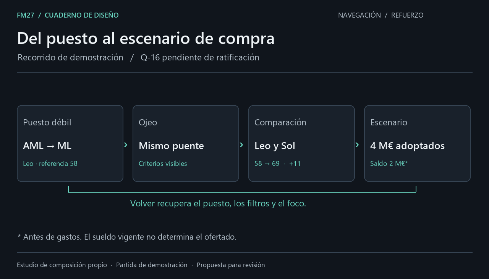

# Navegación que conserva la decisión

**Propuesta evolutiva.** El [mapa de Fase B](../ux-ui/02-navegacion-y-flujos.md) agrupa Resumen, Plantilla, Ojeo, Táctica, Rendimiento, Asistente y Configuración. Sirve de punto de partida para probar si el usuario encuentra la siguiente acción. Los IDs V01–V19 nombran necesidades detectadas. Un mismo destino puede resolver varias y una ficha puede abrirse desde varios ámbitos.

| Origen y decisión | Paso intermedio y salida | Contexto que viaja | Volver, error o revocación |
|---|---|---|---|
| Resumen → debilidad → buscar refuerzos | Abrir AML, ver por qué es frágil y buscar por su puente. La fila ofrece comparar con el titular. | Carrera, corte, táctica, revisión de perfil, puesto, fases y UID del referente. | Recuperar puesto y foco. Si cambió la revisión, presentar la referencia como caducada y pedir actualizar antes de simular. |
| Plantilla → jugador → comparar | Abrir ficha y añadir una segunda persona visible. Si se seleccionaron dos filas, abrir el par directamente. | Ámbito, orden, selección por ID y fecha. | Restaurar selección aunque haya cambiado de página. Si el segundo jugador deja de estar disponible, conservar sólo lo autorizado. |
| Táctica → puesto → candidatos | Desde un marcador o su fila «Buscar para este puesto». Mostrar elegibilidad y suplentes antes de salir a ojeo. | Formación, fase o puente IP/OOP, cuota, bloqueo, A/B, titular o vacante. | Regresar al mismo marcador. Ante vacante permitir buscar y comparar candidatos sin delta frente al titular. |
| Ojeo → comparación → seguimiento | Seleccionar 2–5, cambiar referente y añadir el UID elegido a una lista fechada. Guardar búsqueda conserva sus criterios. | Vista analítica, cohorte si aplica, columnas y origen de la selección. | Al volver recuperar orden y foco. Revalidar criterios guardados cuando cambia el permiso. |
| Cantera → evolución → entrenamiento | Elegir cedido o juvenil, comparar dos cortes y explorar ganancia marginal por rol y método entrenable. | UID, club en cada corte, edad observada y revisión de curva. | Volver al grupo original. Con un solo corte mostrar la fecha y la acción de seguimiento. |
| Jugador → histórico → venta o renovación | Revisar periodos y vencimiento, abrir escenario de venta o identificar el contrato que necesita revisión en FM. | Pertenencia histórica, presente, moneda/periodo, observaciones y vigencia. | Cancelar descarta sólo el escenario. La decisión de renovar se lleva al juego por el usuario. El analizador es de lectura. |
| Estadísticas → comparación → perfiles parecidos | En rendimiento, elegir dos jugadores. Usar métricas visibles del referente como propuesta de filtros editables y abrir resultados en la misma cohorte. | Definición estadística, N, minutos mínimos y filtros aplicados después del cálculo. | Volver al mismo punto/fila. Un índice automático de similitud sería una propuesta de alcance nueva. |
| ChatGPT → recomendación → evidencias | Desde el texto abrir la causa local y desde allí el puesto, el cálculo o la persona. | Carrera, fecha, revisión, entidad y consentimiento de ese contexto. | Si caduca o se revoca el permiso, retirar los datos afectados. Dejar acceso al análisis local vigente incluso sin red. |

### Decisiones de interacción por probar

| Patrón | Uso recomendado y alternativa | Evidencia que inclinaría la elección |
|---|---|---|
| Navegación lateral y búsqueda global | Menú para destinos recurrentes. Búsqueda global **CANDIDATA** de personas visibles o destinos, con tipo y carrera. Alternativa inicial: búsqueda local en tabla y selector de destino. | Probar encontrar un homónimo conocido y volver a la misma consulta. Rechazar cualquier autocompletado que permita enumerar personas fuera de la proyección. |
| Pestañas e inspector | Pestañas para aspectos de la misma persona (atributos, rol, cierres). Inspector para explicación corta. Convertir en detalle completo a ancho estrecho. | Si al completar la tarea se pierde la referencia o el foco, comparar con detalle navegable. Evitar anidar pestañas para una única acción. |
| Comparador persistente y multiselección | Bandeja visible al seleccionar, con quitar, cambiar referente y contador. Seleccionar en varias páginas por UID. Alternativa: comparar directamente desde la fila con referente. | Con cinco fichas, observar si se identifica el par activo. Revalidar selección en cada cambio de contexto. No mezclar carreras. |
| Historial, filtros guardados y columnas | Atrás conserva contexto vigente. Guardar búsqueda conserva parámetros y sus unidades. Ajustar orden y columnas por vista, con acción para restaurar los valores iniciales. | Comprobar filtro suspendido, foco en la fila tras volver y exportación del ámbito elegido aunque abarque varias páginas. |
| Paneles de evidencia y trabajo local | Mostrar la fuente al lado del dato si cabe. A 200 % convertir la explicación en una página con retorno al control de origen. | Abrir una contribución DWRS, identificar perfil y fase y volver al mismo atributo sólo con teclado. |

La restauración de una ruta resuelve IDs otra vez en la carrera y política vigentes. Rechazar un enlace antiguo produce una causa general y retorno al origen. Se conservan preferencias de presentación compatibles y se invalidan las consultas y datos afectados. [Política](../to-be/13-visibilidad-y-juego-limpio.md) · [Pruebas](11-ux-validation-criteria.md)
