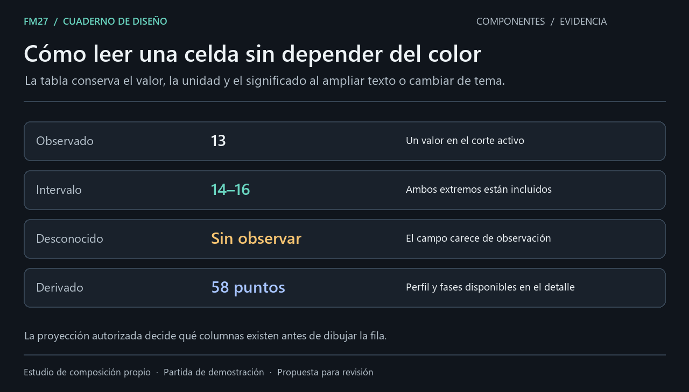

# Identidad de escritorio y lectura de datos

La vista es un puesto de análisis en castellano. La jerarquía propone **contexto de la partida → decisión deportiva → evidencia**. Un título como «Cobertura de AML» y una línea «Club Faro · 14 sep 2027 · IP 50 %» permiten interpretar el resultado aun al volver desde otra vista. El campo táctico, la tabla y el inspector pueden adoptar composiciones diferentes. Se mantiene la misma identidad de jugador, unidad, fecha, semántica del color y mecanismo de retorno.

## Colores con función verificable

Se conservaron los colores del [sistema existente](../ux-ui/01-sistema-de-diseno.md). Se proponen un segundo color para series comparativas y un contorno informativo. Las razones se calcularon con luminancia relativa sRGB, (L mayor + 0,05)/(L menor + 0,05), sobre **Panel #19212B**, con colores sólidos. Verificar las parejas efectivamente renderizadas, también frente al fondo y en selección, hover y tema de contraste.

| Token semántico propuesto | Valor oscuro | Uso y señal adicional | Contraste sobre Panel |
|---|---|---|---:|
| Fondo / Panel | #10151C / #19212B | Lienzo y agrupaciones. Separar primero por espacio y encabezado. | — |
| Texto / Texto secundario | #EEF3F6 / #B5C1CB | Valores, etiqueta, unidades, contexto. | 14,52 / 8,85 |
| Acción y foco | #69D5C0 | Acción principal o anillo continuo. Selección también lleva marca o texto. | 9,18 |
| Serie de referencia | #A8C5FF | Titular con nombre y círculo. Candidato con etiqueta y otra forma/trazo. | 9,35 |
| Atención / Error | #F7C572 / #FF9FA2 | Rango inválido o estado recuperable con causa, icono y texto. | 10,19 / 8,30 |
| Borde decorativo | #354352 | Divisor secundario. Su contraste es insuficiente para definir por sí solo un control o dato. | 1,60 |
| Contorno informativo | #70849A | Borde de campo editable o contorno que identifica una forma en el gráfico. | 4,22 |

Usar recursos temáticos por propósito. En tema de contraste, pinceles y foco del sistema con formas/etiquetas diferenciables. Texto normal al menos 4,5:1. Texto grande y contornos que transmiten información al menos 3:1. Evitar escribir texto blanco sobre el relleno menta. Para botones rellenos probar texto del color de fondo. El escudo y el color del club pueden identificar un club, sin recalibrar estados ni escalas deportivas.

## Tipografía, densidad y comportamiento

| Elemento | Propuesta de partida | Cómo adaptarlo |
|---|---|---|
| Texto | Segoe UI Variable, respaldo Segoe UI. Título 28/34 DIP, sección 20/26, lectura 14/20, tabla compacta 13/18, cifra destacada 24/30. Seminegrita para títulos. | Alinear cifras a la derecha y decimales con precisión común. Usar coma decimal en es-ES, unidad junto a la cifra y signo explícito en diferencias. Nunca redondear antes de ordenar. |
| Ritmo y capas | Cuadrícula de 4 DIP, interiores 12/16, separación 16/24. Radio 4 en controles y 8 en paneles. Borde de 1 DIP decorativo y foco visible de 2 DIP. | Filas propuestas de 36 DIP compactas o 44 cómodas, ampliables con el texto. Reservar material o sombra para superficie transitoria. |
| Iconografía | Glifos de la plataforma con etiqueta para acciones deportivas. Flecha de orden + nombre accesible, candado + «Fijado», advertencia + motivo. | No asignar la misma señal a bloqueo táctico, falta de datos y lesión. Un recurso ausente utiliza iniciales o silueta con tamaño reservado. |
| Marco | Desde 1200 DIP, navegación e inspector opcional. De 900 a 1199, carril y panel superpuesto. Por debajo de 900, menú compacto y detalle navegable con volver. | Medir el ancho efectivo disponible tras escalar Windows. Al ampliar texto mover acciones secundarias a menú con nombre. Conservar asignar, comparar, cancelar y volver. |
| Tablas | Identidad a la izquierda y cifras a la derecha, encabezados persistentes, orden estable y causa de dato ausente accesible. | Columnas secundarias seleccionables, desplazamiento horizontal local. No ocultar el periodo del salario ni la escala de una nota para ganar espacio. |
| Tarjetas e indicadores | Una tarjeta agrupa cifras con la misma pregunta. Cada KPI indica unidad, ámbito y acción si existe. | En resumen mostrar la carencia y el paso siguiente. En una lista larga usar filas. Fotos locales bajo demanda con sustituto por tipo de recurso. |
| Gráficos | Barras con base cero para magnitudes, líneas con cortes fechados y huecos, dispersión con unidades y cohortes visibles. | Patrón/trazo, nombre y tabla equivalente. Los tooltips se abren también por foco. Detener animación al solicitar movimiento reducido. |

## Estados y lenguaje

| Situación | Respuesta visual y de interacción |
|---|---|
| Reposo, puntero, pulsación, foco y selección | Realzar fondo al pasar, conservar contraste al pulsar, marcar selección persistente y foco independiente. Anunciar orden y cantidad seleccionada. Escape cierra el detalle y devuelve foco. |
| Carga, recálculo o cancelación | Nombrar la tarea. Conservar último corte autorizado, su fecha y un indicador de actualización. Cancelar impide publicar una respuesta anterior. |
| Sin datos / sin resultados | Sin carrera ofrecer abrir/vincular. Con filtro sin coincidencias ofrecer revisar criterio. Una vista parcial identifica los campos observables. |
| Fallo de fuente, permisos o imagen | Explicar la capacidad afectada y cómo recuperar el último corte permitido. La ausencia de foto usa iniciales. Revocar permisos retira valores también del árbol accesible, filtros, exportación y conversación afectada. |
| Atributos y métricas | Exacto «13», rango «14–16», desconocido «Sin observar», no aplicable con causa. Un cero real conserva unidad. No exponer existencia de un campo o jugador restringido si ese hecho también es privado. |
| Localización | IDs estables y recursos es-ES. Preparar inglés seleccionable en segunda entrega. Etiquetas como AML, W-IP y WM-OOP sirven para identificar fixtures. La denominación, grupos y orden oficiales españoles precisan evidencia de la build. [Registro terminológico](../to-be/catalogo-terminos-fm27.md) |

Ratón, teclado, foco visible, Narrador/UI Automation, alto contraste y escalas 100–200 % forman parte de las tareas de validación. El cálculo de contraste de esta hoja sólo acredita las muestras nominales. [Aceptación visual existente](../ux-ui/06-criterios-de-aceptacion-visual.md)
