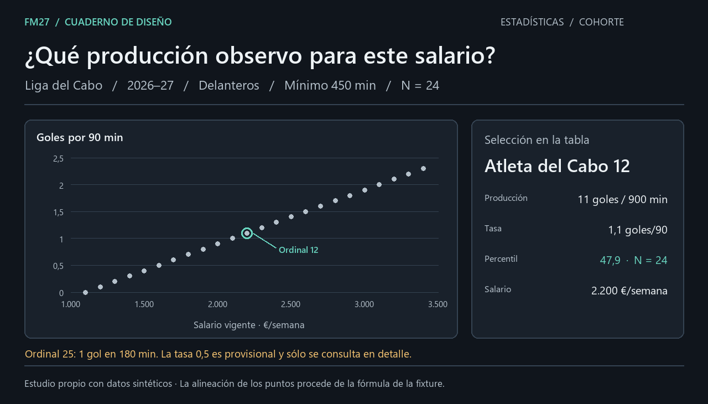

# Superficies candidatas y decisiones que deben sobrevivir a un rediseño

Los IDs V proceden del [catálogo de Fase B](../ux-ui/03-catalogo-de-pantallas.md). Aquí se desarrolla la composición que se probaría y la alternativa que permitiría cambiarla. Los identificadores C remiten a las [piezas candidatas](08-component-candidates.md). En todas las vistas se conserva el ámbito de carrera y fecha. Al cambiar permisos se reconsulta o retira la información, incluso si ya se había mostrado. Carga, vacío, error, foco y contraste siguen el [sistema común](06-design-system.md).

### V01 · Resumen — RECOMENDADA para el mock

**Decisión.** Elegir el primer puesto o contrato que revisar hoy. Al abrir la vista se ven el club, el corte y la táctica activa. Debajo, un XI compacto con una carencia razonada y la acción «Revisar puesto». Situar renovaciones y cambios desde el último corte después de la decisión principal. C02, C08 y C09 permiten enlazar el mismo puesto en todos los pasos. El filtro por equipo o competición cambia el referente de la alerta.

**Ensayo.** Abrir AML, nombrar titular y causa, entrar a ojeo y volver al puesto. Sin táctica, ofrecer elegirla. Si faltan contratos, sigue disponible el bloque deportivo con su fecha. Alternativa: lista de puestos priorizada como vista inicial cuando el campo no añade información. Comparar el tiempo hasta identificar la causa y los retrocesos. [R01 y R04](03-visual-reference-catalog.md) · [V-A1/V-A9](../ux-ui/06-criterios-de-aceptacion-visual.md)

### V06 y V08 · Ficha y explicación por rol — RECOMENDADA para el mock

**Decisión.** Elegir si el jugador encaja y qué falta observar. Cabecera C01 con nombre, pertenencia, corte, pie y posición. Debajo, rol y fase seleccionados, nota con perfil/cobertura (C07) y atributos por grupos oficiales (C06). Abrir la contribución desde la cifra, con intervalo, regla y peso. Contrato e histórico se alcanzan desde la misma identidad. Elegir otra fecha distingue dato observado de nota recalculada.

**Ensayo.** Abrir Mar desde la búsqueda y distinguir Regate 12–14 de Pase sin observar. Con una foto ausente se reserva la misma cabecera. Un enlace a UID no disponible devuelve al origen. Alternativa: análisis por roles en inspector o vista completa según profundidad y escala de Windows. Probar retorno a la misma contribución, pendiente de cotejo del orden oficial FM27. [R03/R05/R09](03-visual-reference-catalog.md) · [FR-01/02/07](../testing/02-casos-de-prueba.md)

### V03 · Plantilla — RECOMENDADA para el mock

**Decisión.** Elegir un titular, un suplente o dos personas que comparar. Tabla C03 con nombre, puesto, edad, disponibilidad, nota para el rol activo y contrato comparable. Dar prioridad a identidad/estado al estrechar la ventana. Filtros de equipo, grupo posicional y disponibilidad. Columnas de salario o fin de contrato seleccionables. Acciones de selección agrupadas sobre la tabla y exportación autorizada del conjunto.

**Ensayo.** Con foco en una fila intermedia, abrir ficha, volver con el mismo UID y comparar dos personas tras reordenar. Comprobar nombre largo, foto ausente, selección entre páginas y plantilla parcial sin inferir bajas. Alternativa: lista con inspector para revisar una persona reiteradamente. Nunca exigir abrir fichas para comprobar una serie completa de sueldos. [B02/B04 y R02](03-visual-reference-catalog.md) · [EQ-038/040](../testing/01-equivalencia-funcional.md)

### V05 y V07 · Ojeo y comparación — RECOMENDADA, variantes de Q-16

**Decisión.** Elegir a quién seguir y determinar si mejora un puesto concreto. Cabecera con referente, puente IP/OOP y vigencia. C04 para criterios con umbral seguro/posible, C03 para resultados y C05 para 2–5 seleccionados. Desde una carencia, abrir el par titular–candidato. Mostrar encaje por fase, delta y coste antes de desplegar atributos. En rendimiento observado se mantiene visible la cohorte y se suspenden criterios que procedan de atributos o permisos especiales. Guardar filtros, comparar y añadir a lista son acciones independientes.

**Ensayo.** En la búsqueda general de Faro, «Sólo seguros» devuelve Sol y «Incluir posibles» añade Mar. En el recorrido contextual comprobar por separado el +11 de Leo/Sol y la franja +1 a +3 de Regate. Con un solo seleccionado, pedir el segundo. Con titular vacante, suprimir delta. Alternativas: bandeja persistente frente a acción contextual, par anclado frente a tabla transpuesta para cinco. Rechazar cualquier opción que pierda el coste o aplique un filtro suspendido. [D01/R02/R06](03-visual-reference-catalog.md) · [NV-25/26](../testing/02-casos-de-prueba.md)

### V09 y V10 · Pizarra, mejor XI y profundidad — RECOMENDADA para el mock

**Decisión.** Fijar un jugador, comparar fases y explicar el reemplazo tras una baja. Campo C08 en el centro. Controles de formación, fase, A/B y competición arriba. Inspector del puesto con titular, restricciones, caída y C09 para profundidad. Bloqueo nombrado y acceso «Asignar» con teclado. Un cambio de fase recupera al mismo UID. Si hay sitio, dos campos facilitan seguir el desplazamiento. En ancho estrecho, una sola fase y una lista de equivalencias.

**Ensayo.** Fijar a Ada con selector y arrastre, cambiar de formación y explicar un conflicto antes del cálculo. Revisar un lesionado y la segunda portera disponible. Una vacante conserva su posición y motivo. Alternativa: tabla puesto → persona → destino de fase como vista principal accesible. Elegir con PC-06 y observaciones del mock. [R07/D02](03-visual-reference-catalog.md) · [FR-03 y NV-19](../testing/02-casos-de-prueba.md)

### V04 y V12 · Cantera, cesiones y desarrollo — RECOMENDADA para el mock

**Decisión.** Elegir quién necesita observación y qué método entrenable se justifica. Agrupar la lista por cantera/cesión con club propietario y destino, edad, minutos y última observación. En detalle C11 con cortes y C07 con ganancia marginal para el rol objetivo. Seleccionar periodo, jugador y rol, ir al plan y volver a la lista filtrada. Separar progresión observada de ganancia hipotética al entrenar un atributo.

**Ensayo.** Seguir a Elia entre dos clubes por UID. Leer los dos cierres de Leo y distinguir +2 en Regate de +4 en nota. Con una fecha sólo hay una observación. Sin edad, aún se puede explicar la ganancia sin prioridad ajustada. Alternativa: tabla fechada junto a la lista si dos cortes bastan. [D03/R08](03-visual-reference-catalog.md) · [NV-11/FR-07](../testing/02-casos-de-prueba.md)

### V14 · Estadísticas y Moneyball — RECOMENDADA para el mock, alcance Q-16

**Decisión.** Buscar producción a un coste comparable. Encabezado C12 con cohorte completa, temporada, posición, minutos mínimos y N por indicador. Debajo, tabla y dispersión enlazadas por UID. Detalle con total, por 90, sentido y minutos. La selección por teclado localiza el mismo punto. Un filtro por percentil o precio reduce resultados conservando la población usada para calcular el percentil.

**Ensayo.** En Cabo, seleccionar ordinal 12, leer 1,1 goles/90 y P47,9 con N=24. Abrir el caso de 180 minutos en detalle. Si falta sueldo, excluir del gráfico que lo requiere y explicar en tabla. Un N pequeño conserva las cantidades disponibles. Alternativas: barras percentiles en el inspector y radar secundario para explorar forma. La pizza queda como referencia investigada. [B06/B07/B09, R03](02-product-benchmark.md) · [NV-12/13/26](../testing/02-casos-de-prueba.md)

La diagonal exacta de D06 procede de cómo el guion genera goles y salarios. Sirve para verificar la selección reproducible entre punto y fila. [Datos de Cabo](../ux-ui/05-especificacion-prototipo-html.md)

### V18 · Asistente ChatGPT — RECOMENDADA como simulación

**Decisión.** Entender el motivo de una recomendación y volver al cálculo local. Cabecera con estado, ámbito y acción para revisar el contexto. C13 organiza consulta, respuesta parcial y cancelación. C14 enlaza cada conclusión con el puesto, la métrica o el cálculo en su revisión. El botón «Explicar» puede abrir primero el desglose local de C07. Controles de contexto por carrera, fecha y selección visible.

**Ensayo.** Respuesta preescrita sobre AML lleva a Leo/Sol con las cifras del escenario. Probar fallo, desconexión y revocación durante la respuesta. Retirar datos afectados y conservar navegación local vigente. Alternativa: panel contextual para una consulta breve y página completa para historial. El plan/credencial real queda en Q-09/PC-09. [Asistente TO-BE](../to-be/14-asistente-chatgpt.md) · [NV-15/16 y V-A7](11-ux-validation-criteria.md)

### Otras superficies y operaciones

| Vista y madurez | Pregunta, distribución y acción | Filtros, fallo o incertidumbre | Alternativa y comprobación |
|---|---|---|---|
| V02 · Sesión/carrera — RECOMENDADA | ¿Qué corte es fiable? Lista de carreras y resumen por vía/campo. C02/C18 revisan origen, páginas y conciliación antes de confirmar una carga. | Filtrar por estado/fecha. Build incompatible conserva sólo datos aún autorizados con fecha. UID ambiguo requiere revisión. | Inspector en el selector global. Pasar de Faro a Bruma con UID coincidente y recuperar tras fallo de lote. NV-02/05, FR-05. |
| V11 · Escenario de mercado — RECOMENDADA | ¿Qué puedo pagar y qué cambia en A/B? C10 pone en paralelo entradas económicas, hipótesis y efecto deportivo. Guardar copia o descartar. | Horizonte, moneda y referente. Si falta precio o conversión, saldo indeterminado. | Extensión del comparador. Con Sol, adoptar 4 M€ deja 2 M€ antes de gastos. NV-27. B10/D04. |
| V13 · Personal — CANDIDATA (A) | ¿Qué función carece de cobertura? Tabla por empleado/función con escala, desglose C07 y acción para buscar criterios. | Club, fecha y función. Categoría desconocida impide valorar. | Pestaña de Plantilla. Comprobar estimación y etiquetas en NV-10. B04/E09. |
| V15 · Cierres — RECOMENDADA | ¿Cambió el equipo o su composición? C11 con dos fechas, altas, bajas, integrantes comunes y acceso a ficha histórica. | Comparar cohortes y perfil original/recalculado. Sin segundo corte, evitar delta. | Pestaña de Rendimiento. NV-14, FR-07/09. B02/B03. |
| V16 · Inscripción — RECOMENDADA | ¿Qué impide presentar esta lista? C16 con cupos, exenciones y motivos, acción local para simular y aplicar. | Competición y revisión, filtrar casos inciertos. Formación desconocida deja la reserva sin acreditar. | Panel dentro de Táctica. Verificar revisión de elegibilidad antes del siguiente XI. EQ-029/030/031. B03. |
| V17 · Perfiles — RECOMENDADA | ¿Qué pesos conviene activar? Biblioteca, borrador C17 y comparación del mismo jugador con C07. | Rol y revisión. Curva inválida mantiene último borrador válido. | Inspector de rol y editor ampliado para veinte niveles. EQ-033/042, FR-07. B04. |
| V19 · Configuración — RECOMENDADA | ¿Qué datos permito y con qué ámbito? Secciones de privacidad C15, gráficos, filosofía, idioma, cuenta y recuperación. Previsualizar efecto. | Filtrar por sección. Falta de capacidad y falta de permiso tienen consecuencias distintas. Cancelar restaura estado. | Accesos contextuales desde ficha o error. NV-04/06/17/18/23, FR-04. D05. |

La exportación y la revisión de importación pueden ser operaciones contextuales, y la inscripción nacional P se reestudiará cuando se acredite elegibilidad. El [brief](10-html-prototype-brief.md) propone cuánto detalle probar en cada recorrido. La [matriz](13-traceability-to-to-be.md) conserva las capacidades que podrían quedar ocultas al fusionar vistas.
