# Comparar presentaciones para una misma tarea

**Balance del primer atlas.** Sus 15 archivos locales incluían nueve capturas de dos productos y seis estudios propios. Servían para explicar la propuesta de Faro. La selección dejaba poca diversidad para elegir cómo presentar una operación económica, un permiso o una conversación con fuentes.

Este tablero reúne alternativas para las 19 superficies y los 18 componentes candidatos. Agrupa las funciones que comparten una decisión visual. Cada imagen lleva a su original a tamaño completo. Las referencias que sólo pueden consultarse en origen llevan un enlace en su celda. Los códigos D identifican ilustraciones propias con datos ficticios. Las analogías de otros dominios aportan opciones de presentación, mientras la semántica deportiva y la visibilidad proceden del TO-BE. [Procedencias y condiciones por archivo](references/manifest.json) · [Matriz por requisito](13-traceability-to-to-be.md)

**Para decidir en Fase B.** Comparar primero las imágenes de una fila, escoger las dos composiciones que interesaría ensayar con la misma fixture y anotar qué error de interpretación resolvería cada una. Es válido preferir una composición para escritorio amplio y otra para teclado o texto ampliado. La elección de estilo queda pendiente de la revisión del propietario.

## Tres maneras de dar protagonismo a los datos

| Ficha editorial · FM Season Hub | Mesa de análisis · FM Player Analyzer | Inspector contextual · Visual Studio Code |
|---|---|---|
| [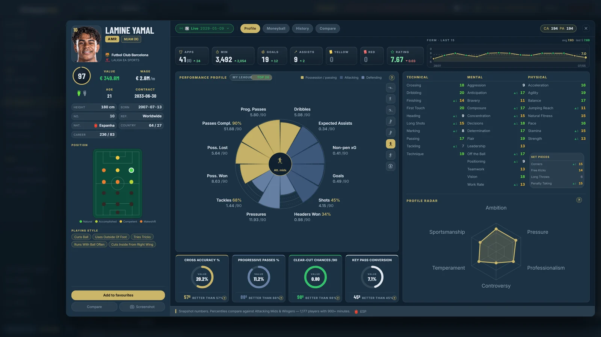](references/statistics/fmsh-perfil.webp) | [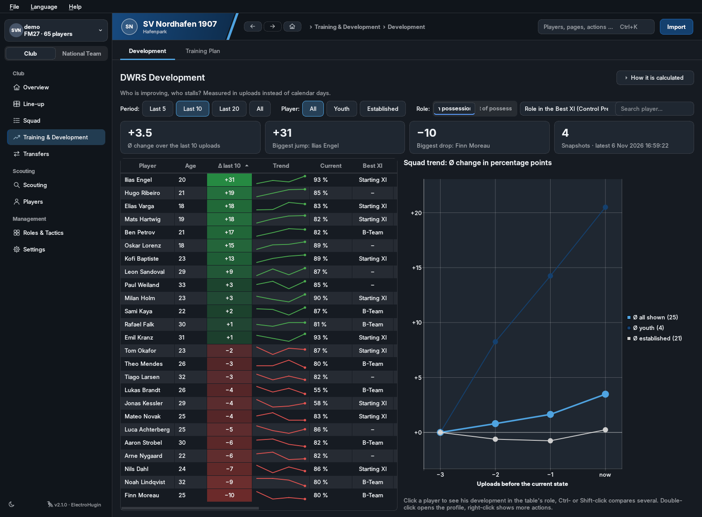](../../old_version/docs/screenshots/en/development.png) | [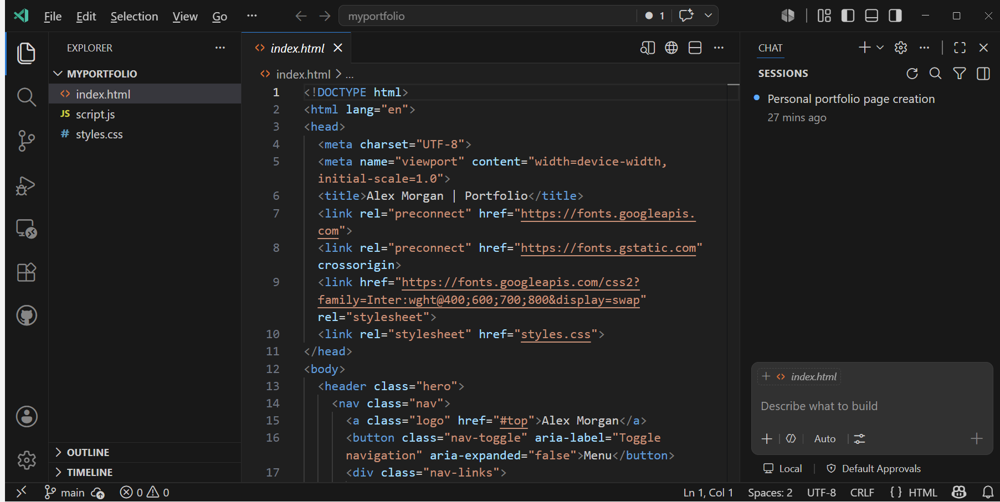](references/navigation/chat-editor.png) |

**Qué tomar para Faro.** En la primera imagen se reconoce enseguida a la persona. La ficha individual puede aprovechar esa jerarquía, especialmente cuando hay retrato, sin dar más peso a la foto que a la fecha y al rol. En la segunda, las filas y los minigráficos permiten recorrer muchos jugadores conservando un eje común. Es la dirección que probaría para plantilla y desarrollo. En la tercera, el panel se distingue por posición y separación mientras el contenido principal sigue a la vista. Es una buena hipótesis para abrir el desglose de DWRS o una explicación de ChatGPT.

La propuesta de identidad puede combinar estas tres proporciones con los mismos colores, cifras alineadas y estados de foco. Para elegir la densidad, comparar la ficha de un juvenil con la tabla de toda la plantilla en el mismo monitor a 150 %. ¿Se identifica igual de rápido a la persona seleccionada? ¿Se sigue leyendo el intervalo del atributo sin abrir otro panel? [Tokens y contraste medido](06-design-system.md)

## El resumen del club

V01 · C02 · C09

| Portal de temporada | Campo y plantilla | Presupuesto por periodos |
|---|---|---|
| [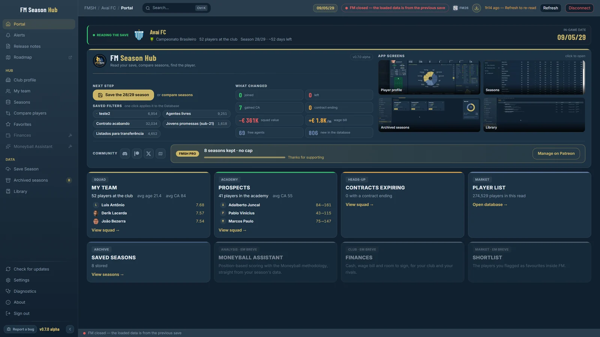](references/dashboard/fmsh-portal.webp) | [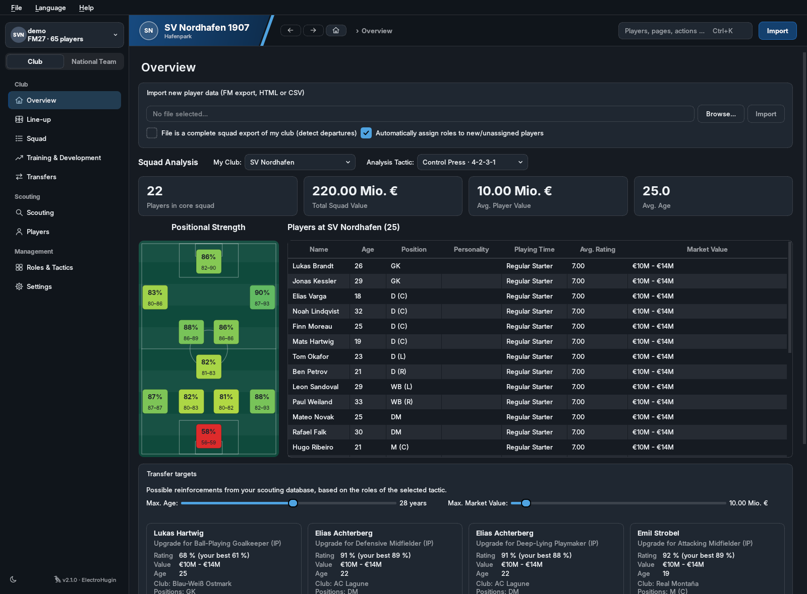](../../old_version/docs/screenshots/en/dashboard.png) | [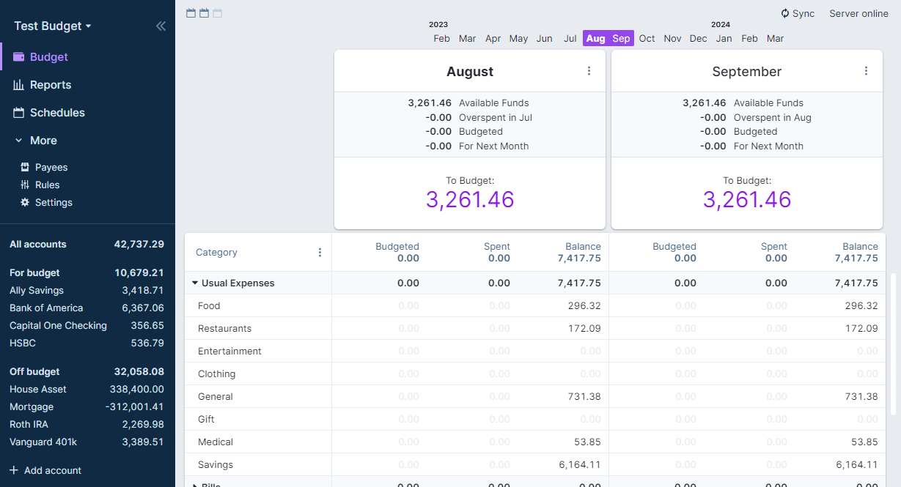](references/dashboard/presupuesto-actual.png) |
| R01 · FM Season Hub | R04 · FM Player Analyzer 2.3.1 | R21 · Actual Budget |

Para decidir a quién alinear, el campo centra la atención en el puesto. Para detectar novedades, el portal permite saltar a varios asuntos. El presupuesto mensual de Actual Budget ofrece una tercera composición para la lectura económica.

**Prueba propuesta.** Abrir Faro y pedir qué puesto revisar y por qué. Comparar qué información queda visible cuando el usuario entra por una renovación.

## Sesión, corte y recuperación

V02 · C02 · C18

| Actividad cronológica | Aviso en la propia vista | Cabecera de contexto |
|---|---|---|
| [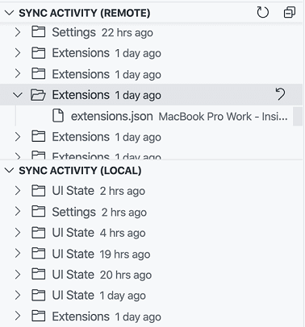](references/navigation/actividad-sync.png) | [Abrir imagen en origen](https://learn.microsoft.com/en-us/windows/apps/develop/ui/controls/images/infobar-warning-title-message.png) |  |
| R19 · Visual Studio Code | E19 · Microsoft Learn · WinUI | R01 · FM Season Hub |

La cronología facilita investigar de dónde procede el último corte. Una banda junto al resultado explica antes por qué falló la actualización. La fecha de juego debe seguir visible en ambos casos.

**Prueba propuesta.** Simular fuente incompatible. El participante debe encontrar qué dato sigue vigente, de qué carrera procede y cómo reintentar.

## Plantilla y ficha de jugador

V03 · V06 · C01 · C03 · C06

| Lista para comparar filas | Tarjeta sobre la lista | Ficha para leer roles |
|---|---|---|
| [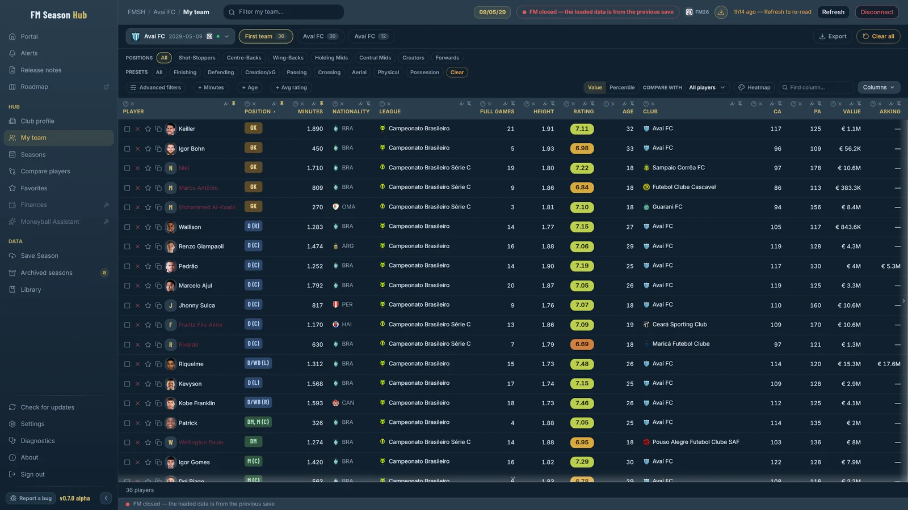](references/scouting/fmsh-equipo.webp) | [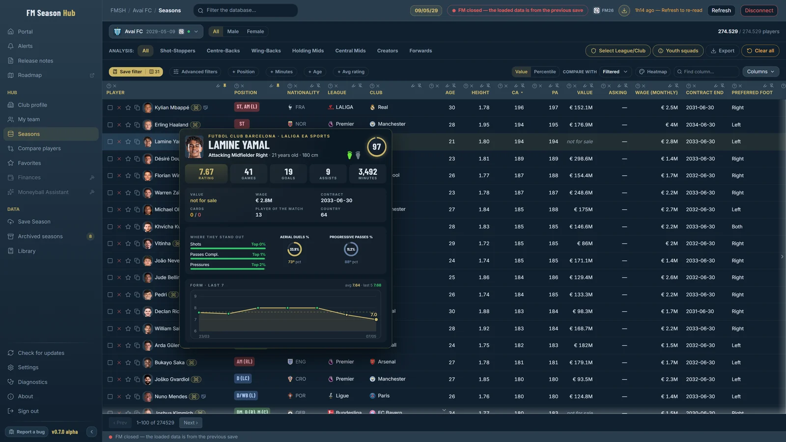](references/players/fmsh-tarjeta.webp) | [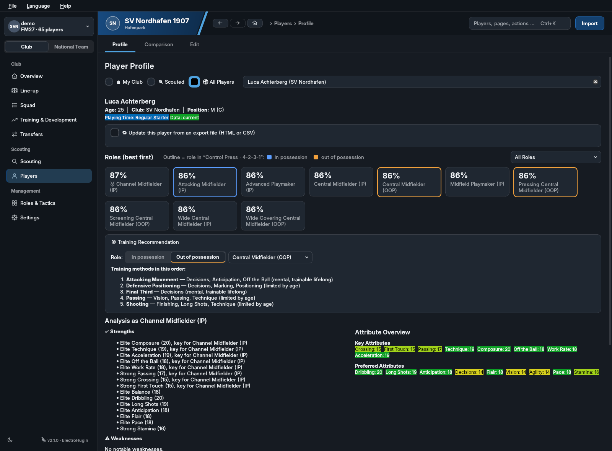](../../old_version/docs/screenshots/en/profile.png) |
| R11 · FM Season Hub | R10 · FM Season Hub | R05 · FM Player Analyzer 2.3.1 |

La tabla facilita recorrer contratos y edades. La tarjeta permite inspeccionar una persona conservando las filas vecinas. La ficha da espacio a la explicación por rol. Un retrato ausente debe ocupar el mismo espacio.

**Prueba propuesta.** Abrir a Mar desde una fila, explicar qué se sabe de su Pase y volver al mismo punto con teclado. Comprobar si hace falta la ficha completa.

## Ojeo y criterios

V05 · C03 · C04

| Filtros sobre columnas | Puesto y formulario | Sólo criterios modificados |
|---|---|---|
| [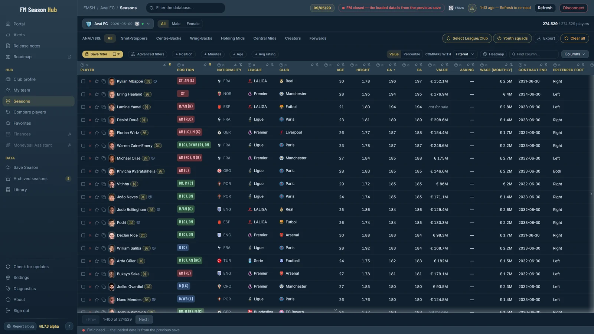](references/scouting/fmsh-base.webp) | [Abrir imagen en origen](https://cdn.footballmanager.com/site/inline-images/5.RECURITMENT_CREATION.png) | [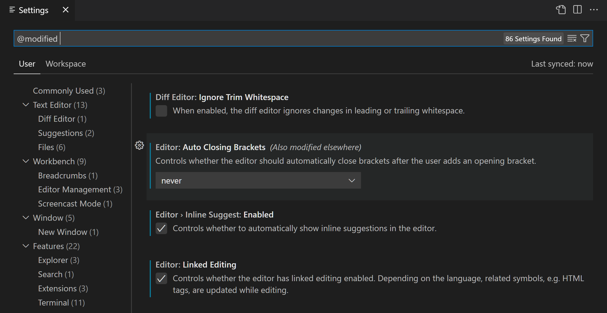](references/components/ajustes-modificados.png) |
| R02 · FM Season Hub | E13 · Football Manager 2023 | R20 · Visual Studio Code |

Para explorar sin puesto prefijado, la tabla da acceso inmediato a los resultados. Al buscar un refuerzo concreto, el dibujo de posición fija el referente. El filtro de ajustes modificados de VS Code sugiere cómo hacer visibles criterios activos o suspendidos en una lista larga.

**Prueba propuesta.** Buscar con Regate mínimo 14. Pasar de encaje a rendimiento y pedir que se identifique qué criterio ha quedado suspendido.

## Par de comparación y explicación

V07 · V08 · C05 · C06 · C07

| Duelo simétrico | Radar y tabla por atributo | Titular y candidato |
|---|---|---|
| [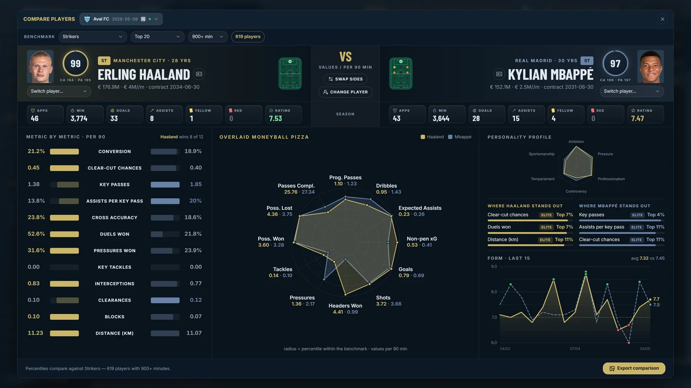](references/players/fmsh-comparar.webp) | [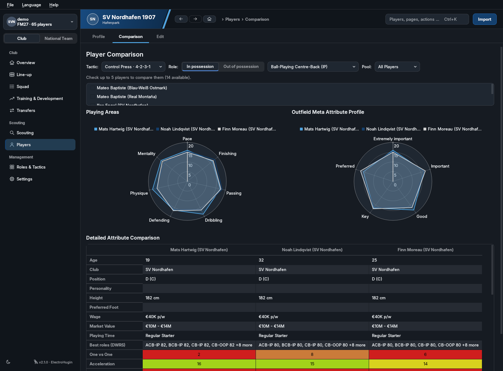](../../old_version/docs/screenshots/en/comparison.png) | [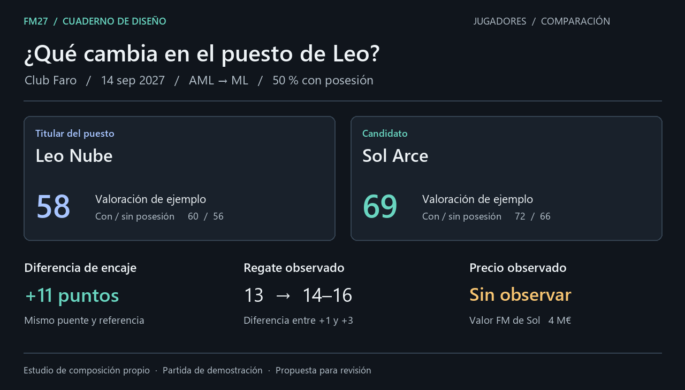](references/players/comparacion-faro.png) |
| E02 · FM Season Hub | R06 · FM Player Analyzer 2.3.1 | D01 · FM27 Analyzer · estudio propio |

Las dos primeras capturas tratan a los jugadores como pares equivalentes. El estudio de Faro da prioridad a la diferencia respecto de un titular concreto. En una selección de cinco, la tabla también permite buscar una cifra exacta sin descifrar cinco contornos.

**Prueba propuesta.** Pedir las diferencias en encaje y en Regate, y a qué jugador se refiere el signo. Repetir tras cambiar el referente y con una vacante.

## Planificador, fases y profundidad

V09 · V10 · C08 · C09

| Dos fases en paralelo | Puesto con lista lateral | Matriz de tácticas |
|---|---|---|
| [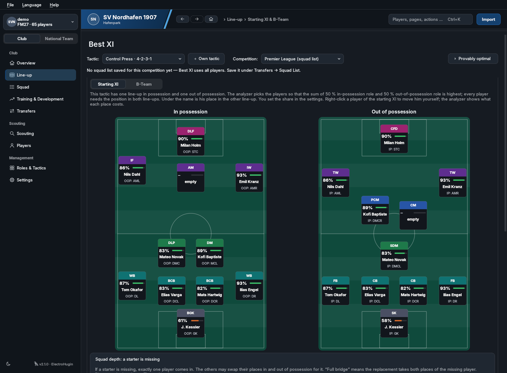](../../old_version/docs/screenshots/en/best-xi.png) | [Abrir imagen en origen](https://cdn.footballmanager.com/site/inline-images/1.SQUAD_PLANNER_ENG.png) | [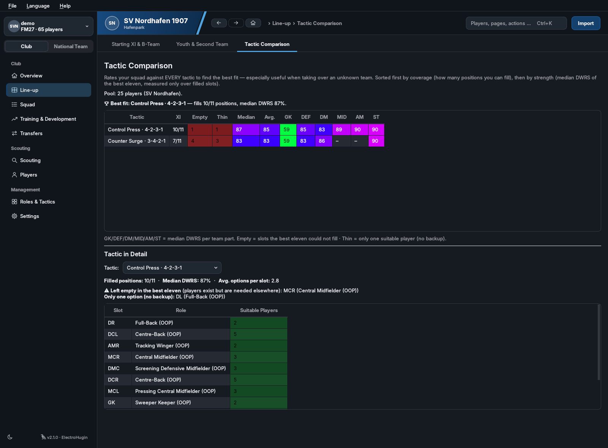](../../old_version/docs/screenshots/en/tactic-explorer.png) |
| R07 · FM Player Analyzer 2.3.1 | E11 · Football Manager 2023 | R12 · FM Player Analyzer 2.3.1 |

Dos campos muestran dónde reaparece el mismo jugador. Un campo con lista hace más fácil identificar al segundo candidato para un puesto. La matriz sirve para cribar formaciones antes de abrir una.

**Prueba propuesta.** Seguir a Leo de AML a ML, simular una baja y nombrar al reemplazo. Repetir a 150 % y por teclado. El campo de FM23 es una referencia histórica de organización.

## Cantera, entrenamiento e histórico

V04 · V12 · V15 · C11 · C07

| Tendencia por jugador | Etapas de carrera | Plan por persona |
|---|---|---|
|  | [Abrir imagen en origen](https://cdn.footballmanager.com/site/inline-images/3.EXPERIENCE_MATRIX.png) | [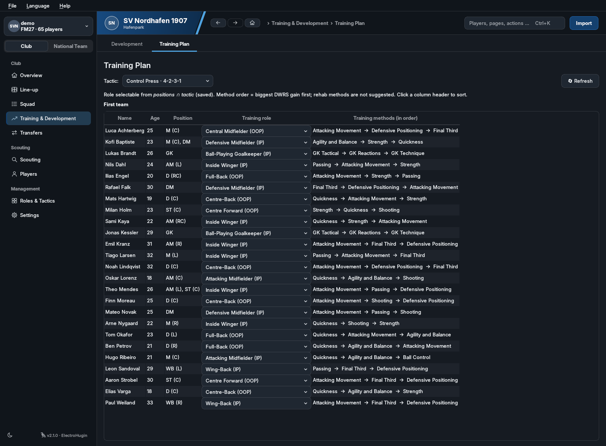](../../old_version/docs/screenshots/en/training.png) |
| R08 · FM Player Analyzer 2.3.1 | E12 · Football Manager 2023 | R13 · FM Player Analyzer 2.3.1 |

Una serie fechada permite discutir qué ha cambiado. La matriz agrupa jugadores para una revisión de cantera y la lista enfrenta varios planes de entrenamiento en poco espacio. La etapa en la matriz histórica depende de su fuente.

**Prueba propuesta.** Localizar a Elia antes y después de la cesión, después abrir el rol objetivo. Para sólo dos fechas, contrastar también la lámina D03 de cierres de Faro.

## Escenario económico

V11 · C10

| Saldo y partidas | Condiciones del agente | Importe pendiente en el par |
|---|---|---|
|  | [Abrir imagen en origen](https://cdn.footballmanager.com/site/inline-images/7.AGENT_DEMAND.png) |  |
| R21 · Actual Budget | E14 · Football Manager 2023 | D01 · FM27 Analyzer · estudio propio |

El presupuesto hace auditable la suma. El mensaje sobre condiciones concentra los términos de un jugador. El estudio propio enseña por qué el encaje ya se puede comparar mientras el precio observado sigue vacío.

**Prueba propuesta.** Antes y después de adoptar 4 M€, pedir el saldo y qué representa el sueldo. La cifra de valor FM nunca acredita una oferta.

## Cuerpo técnico

V13 · C03 · C07

| Inventario con nombres | Barras por función | Accesos por responsabilidad |
|---|---|---|
| [Abrir imagen en origen](https://www.passion4fm.com/img/football-manager-backroom-staff-coaching-team-view.webp) | [Abrir imagen en origen](https://www.passion4fm.com/img/football-manager-coaching-team-comparison.png) | [Abrir imagen en origen](https://cdn.footballmanager.com/site/inline-images/1_10.jpg) |
| E16 · Passion4FM · Football Manager 2024 | E17 · Passion4FM · Football Manager | E15 · Football Manager 26 |

El inventario permite localizar a la persona. Las barras permiten detectar categorías con menor cobertura si se conoce el referente. El selector de responsabilidades permite organizar la navegación alrededor de una tarea. Las tres imágenes se abren en origen.

**Prueba propuesta.** Identificar qué función revisar y después explicar la nota de Vera. Comprobar que un atributo desconocido conserva su estado al pasar de grupo a persona.

## Moneyball y cohortes

V14 · C12

| Nube con punto enlazado | Pizza dentro de la ficha | Radar de comparación |
|---|---|---|
| [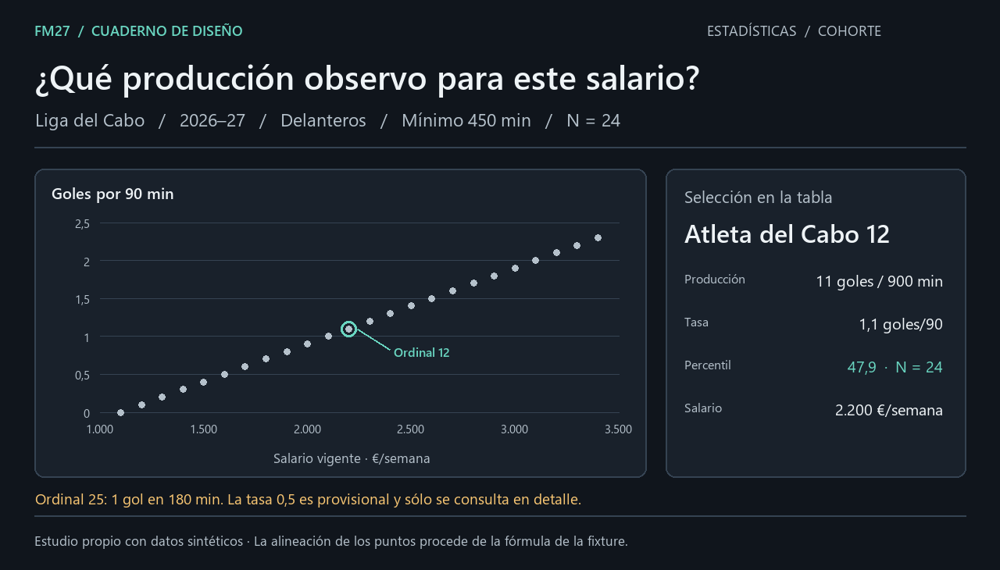](references/statistics/cohorte-cabo.png) |  | [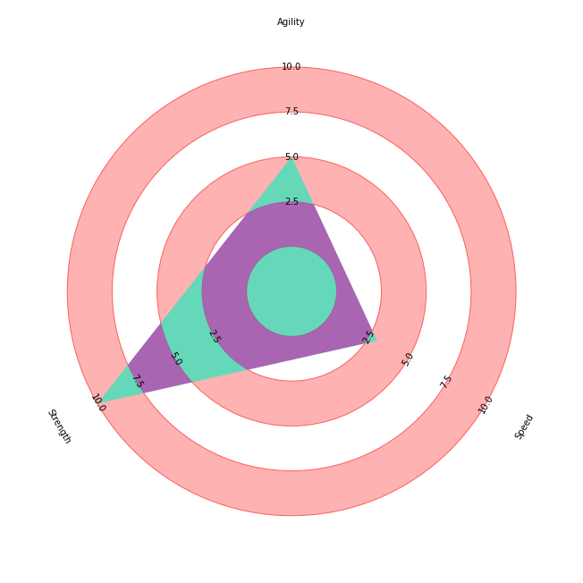](references/statistics/radar-mplsoccer.png) |
| D06 · FM27 Analyzer · estudio propio | R03 · FM Season Hub | R22 · mplsoccer |

La nube responde a una pregunta de coste y producción. La pizza agrupa variables de una persona y el radar superpone formas. Leer las diferencias sobre ejes con escalas o muestras distintas puede producir una comparación engañosa.

**Prueba propuesta.** Localizar k=12 y explicar qué significa 1,1 goles/90 frente a P47,9 con N=24. Verificar los extremos y los jugadores omitidos en la tabla. La pizza sólo se estudia como referencia.

## Inscripción y cupos

V16 · C16

| Lista individual histórica | Resumen antes y después |
|---|---|
| [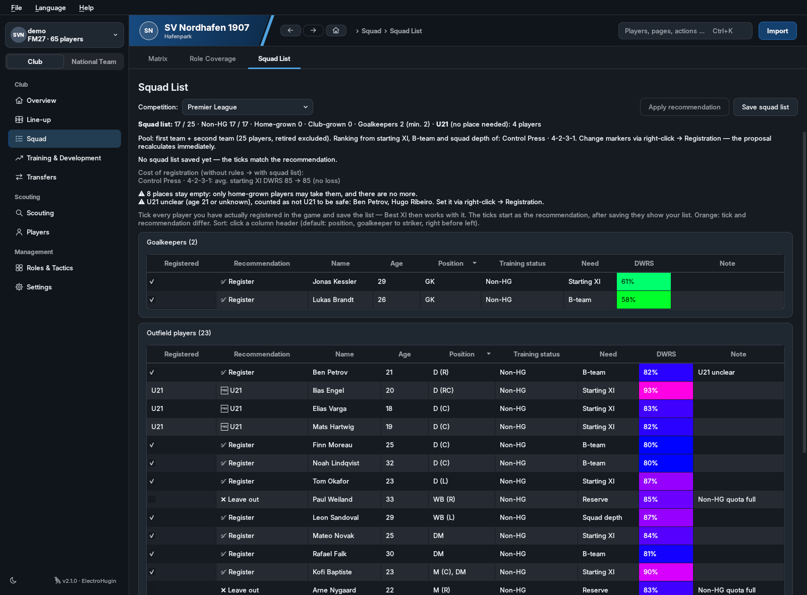](../../old_version/docs/screenshots/en/registration.png) | [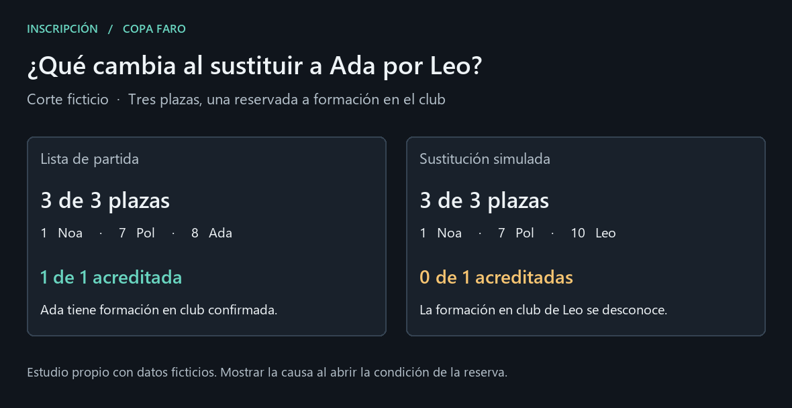](references/components/cupo-faro.png) |
| R14 · FM Player Analyzer 2.3.1 | D07 · FM27 Analyzer · estudio propio |

Aquí se dispone de una captura externa al producto nuevo y un estudio ficticio. La lista muestra quién está inscrito. El resumen permite apreciar que un cambio altera la reserva aunque las plazas ocupadas sean idénticas.

**Prueba propuesta.** Cambiar a Ada por Leo. Pedir qué condición ha dejado de estar acreditada y abrir el motivo. Falta observar si el resumen basta sin la lista siempre visible.

## Biblioteca y editor de perfiles

V17 · C17 · C07

| Biblioteca y contenido | Curva manipulable | Efecto por rol |
|---|---|---|
| [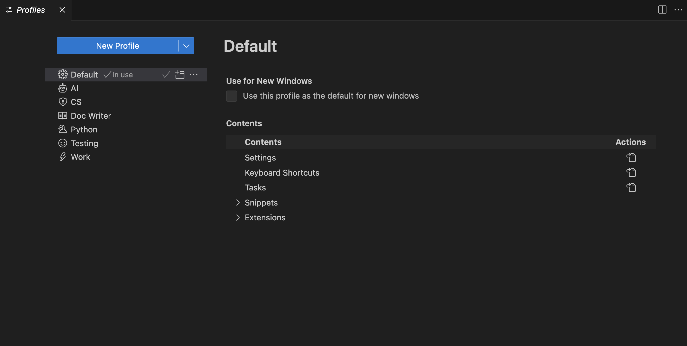](references/components/editor-perfiles.png) | [Abrir imagen en origen](https://docs.gimp.org/3.0/en/images/menus/colors/curves-dialog.png) | [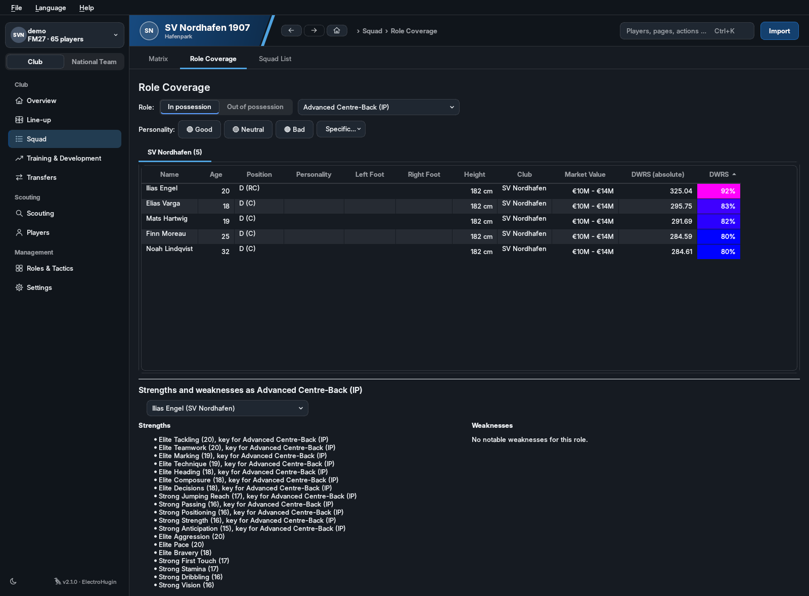](../../old_version/docs/screenshots/en/role-analysis.png) |
| R18 · Visual Studio Code | E18 · GIMP 3.0 | R09 · FM Player Analyzer 2.3.1 |

La biblioteca ayuda a identificar qué definición está activa. La cuadrícula de GIMP permite observar el efecto de mover un punto. Para el perfil deportivo interesa conectar ese gesto con una tabla de veinte niveles y una valoración concreta.

**Prueba propuesta.** Editar un punto que rompa la monotonía y volver a la revisión activa. Comprobar que un usuario de teclado puede corregir el mismo valor.

## Asistente y vuelta a la evidencia

V18 · C13 · C14

| Panel junto al trabajo | Conversación con citas | Detalle de la fuente |
|---|---|---|
|  | [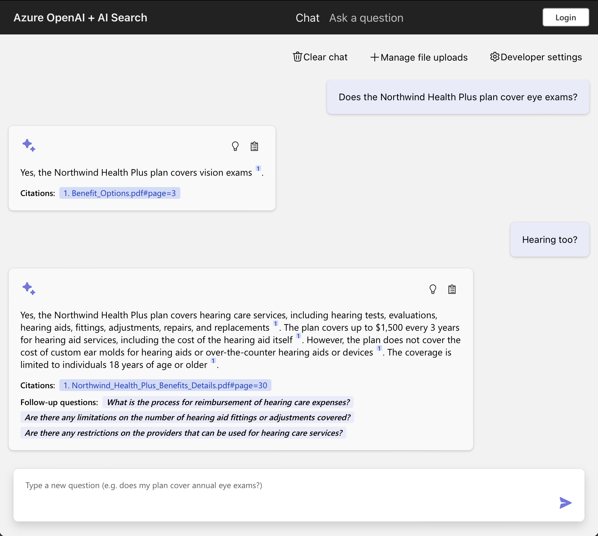](references/components/chat-citas.png) | [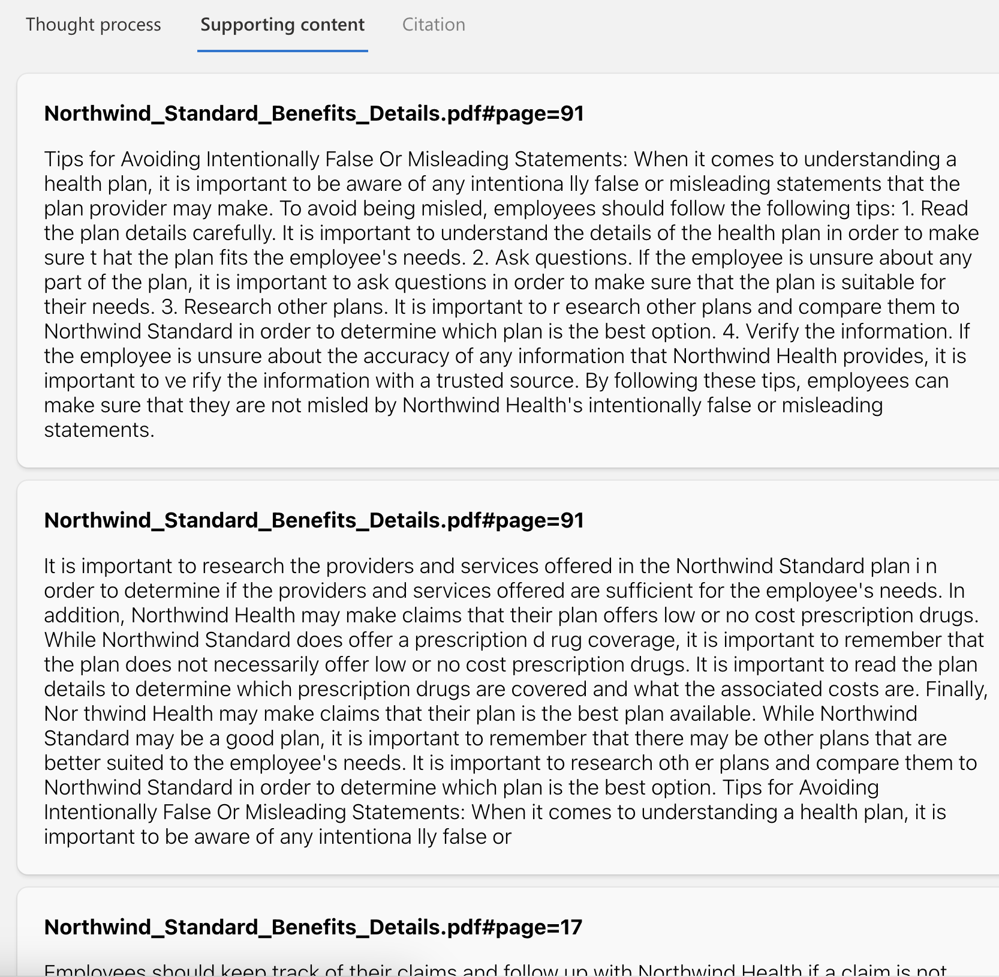](references/components/respuesta-evidencia.png) |
| R15 · Visual Studio Code | R24 · Azure Search OpenAI Demo | R23 · Azure Search OpenAI Demo |

El panel deja a la vista el puesto que originó la pregunta. Un hilo amplio da espacio a la explicación. En la demo de Azure las citas llevan a contenido identificado por documento y página. En Faro ese destino debe resolver jugador, fecha y revisión autorizados.

**Prueba propuesta.** Abrir el origen del +11 y volver al mismo puesto. Repetir con revisión caducada. R16 muestra además cómo podría elegirse el contexto antes de enviar la pregunta.

## Ajustes, alcance y permisos

V19 · C15 · C04

| Preferencias por ámbito | Consentimiento expreso | Selector de contexto |
|---|---|---|
|  | [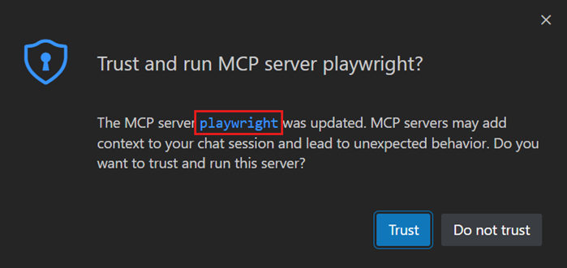](references/components/aviso-confianza.png) | [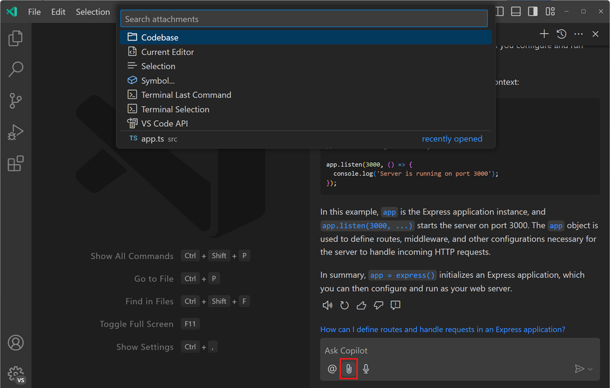](references/components/chat-contexto.png) |
| R20 · Visual Studio Code | R17 · Visual Studio Code | R16 · Visual Studio Code |

La búsqueda por ámbito ayuda a encontrar una preferencia de carrera. Un diálogo de confirmación destaca la consecuencia de habilitar un campo. El selector de contexto responde a una tercera decisión, qué se enviará al asistente.

**Prueba propuesta.** Cancelar el aviso de PA, aceptarlo después y revocar. Pedir que se identifique qué campo se habilitó y qué datos se compartirían. El permiso de lectura y el de envío se comprueban por separado.

## Qué sigue necesitando contraste

La sesión/carrera tiene analogías de historial y aviso, pero falta observar con usuarios si se distingue fecha de captura de fecha del juego. En inscripción sólo se identificó una captura de la tarea deportiva acompañada de una composición propia. El personal dispone de varias imágenes deportivas públicas, aunque los dos ejemplos de evaluación proceden de la misma guía. Los ejemplos de chat, permisos, presupuesto y curvas enseñan convenciones de otros productos. La revocación durante una consulta, el foco después de volver y el comportamiento con 150.000 filas requieren pruebas de interacción. [Criterios de validación](11-ux-validation-criteria.md)

Las condiciones de conservación y los avisos de cada editor figuran en el [atlas](03-visual-reference-catalog.md). Ninguna composición del tablero adquiere por su inclusión el estado de VALIDADA.
