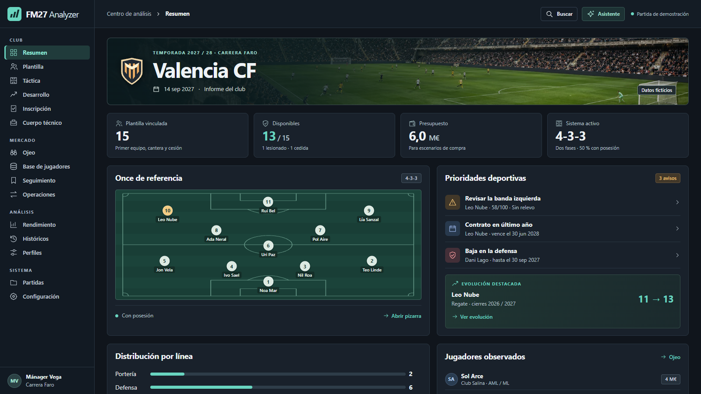

# FM27 Analyzer · prototipo interactivo

Abre [index.html](index.html) en Microsoft Edge para entrar en la partida ficticia de Valencia CF. La demo utiliza HTML, CSS y JavaScript clásico con recursos locales. Puedes copiar la carpeta `prototype/html` y abrirla con la red desconectada. La ejecución requiere únicamente el navegador.

En PowerShell, desde la raíz del repositorio, ejecuta este comando.

```powershell
Invoke-Item .\prototype\html\index.html
```



## Primer recorrido

1. En **Resumen**, abre **Revisar la banda izquierda**. El inspector de AML muestra a Leo Nube, su nota y los relevos disponibles.
2. Pulsa **Buscar refuerzo** y **Comparar** en la fila de Sol Arce. Revisa las dos fases, el Regate y el sueldo de ambos jugadores.
3. Abre **Simular refuerzo**. Observa el saldo antes y después de **Adoptar valor de mercado**. Puedes probar otro importe, guardar el escenario y volver al puesto.
4. En **Táctica**, alterna con y sin posesión. Cambia la formación, fija un titular o prueba una sustitución desde el selector o por arrastre.
5. En **Ojeo**, busca AML con edad máxima 21, valor máximo 6 M€ y Regate mínimo 14. Alterna **Sólo seguros** e **Incluir posibles** y guarda la búsqueda. **Seguir** añade un UID a **Seguimiento**, donde puedes crear listas propias.
6. En **Rendimiento**, conserva Liga del Cabo y 450 minutos. Aplica percentil mínimo 47 y compara dos delanteros. En **Históricos** puedes consultar los dos cierres de Leo y abrir su entrenamiento.

**Ctrl+K** busca personas o destinos en la carrera activa. **Volver** o **Esc** recuperan la vista anterior. **Tab**, **Mayús+Tab** e **Intro** permiten recorrer controles y diálogos. Las flechas recorren los marcadores de la pizarra.

## Datos y estado

Faro reúne 139 futbolistas ficticios. Incluye 15 vinculados a Valencia CF, tres objetivos del Club Salina, 25 delanteros del Cabo y 96 registros sintéticos adicionales. El corte de Faro es el 14 de septiembre de 2027. Bruma permite comprobar el aislamiento con otra persona bajo el mismo UID 1. Datos deportivos, notas e importes proceden de la demostración. La imagen de estadio es una creación para el prototipo y el escudo es geométrico.

Los datos y la construcción del estado están en [data.js](data.js). Las vistas comparten identidades, observaciones, selección y permisos dentro de cada carrera. Al cambiar de carrera se conservan los planes de ambas en memoria. Recargar la página o elegir **Configuración → Reiniciar demostración → Restaurar datos originales** restablece las dos carreras.

CA y PA requieren consentimientos independientes. Sólo Sol Arce dispone de esos campos ficticios. Revocar el permiso retira el dato de las vistas y limpia los criterios afectados en las búsquedas guardadas. Un intervalo permanece como intervalo. El signo **≈** identifica una estimación.

## Alcance de la simulación

La pizarra asigna jugadores aptos a puestos compatibles. Las notas IP/OOP son las del guion y el XI usa una búsqueda limitada a esta plantilla. El editor de perfiles es un ejercicio con dos atributos. Las temporadas y las reglas de Copa Faro tienen observaciones y cupos prefijados.

El asistente ofrece respuestas locales y enlaces al análisis. La sincronización cambia estados de demostración. La exportación a Excel o CSV presenta una vista previa de filas y columnas. Estas operaciones funcionan sin credenciales, conexión al juego, SQLite ni servicios de IA.

## Repetir la validación

La aplicación se entrega en sus archivos ejecutables de navegador. La comprobación estática recorre los scripts con Node. Los recorridos usan Python, Playwright y una instalación de Microsoft Edge. Los comandos siguientes se ejecutan desde la raíz en PowerShell. El entorno virtual sólo se necesita para las pruebas.

```powershell
Get-ChildItem .\prototype\html\*.js | ForEach-Object {
    node --check $_.FullName
    if ($LASTEXITCODE -ne 0) { throw "Error de sintaxis en $($_.Name)" }
}

$entornoPruebas = Join-Path $env:TEMP 'fm27-pruebas-html'
python -m venv $entornoPruebas
$pythonPruebas = Join-Path $entornoPruebas 'Scripts\python.exe'
& $pythonPruebas -m pip install playwright==1.65.2
& $pythonPruebas -X utf8 .\prototype\html\tests\review.py
```

Añade `--capture` al último comando para actualizar [las capturas propias](review/). El script abre el archivo local con la red desactivada y falla ante excepciones JavaScript o solicitudes HTTP. El [registro de implementación y cobertura](IMPLEMENTACION.md) identifica los resultados, los requisitos representados y las comprobaciones pendientes del propietario.
